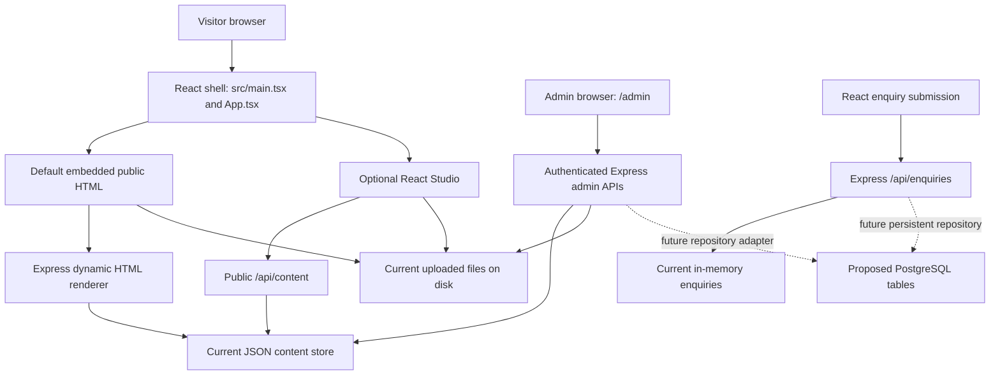
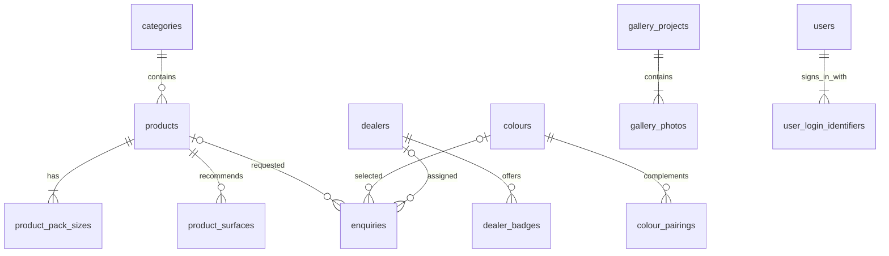

# Areva Paints — Complete Technical Documentation

**Reviewed:** 11 November 2026

**Repository:** https://github.com/areva-Paints/areva-paint_new

**Application baseline:** GitHub `main` at `7d0656e` — illustrated cards for all eight product categories, individual accounts/logout and private activity history included

**Scope:** frontend, backend, content storage, APIs, authentication, uploads, deployment, testing and proposed PostgreSQL database, including complete table definitions below.

This is a source-code review and technical handover, not a claim that every browser/device or live deployment has been tested. It covers the application entry points, components, public HTML runtime, admin modules, server routes, configuration, packaging scripts, tests and local SQL proposal. Images and prebuilt ZIP archives are assets, not additional application frameworks. Comments and marketing labels have been checked against implemented code where they differ.

## Contents

1. Current implementation and technology stack
2. Architecture and data flow
3. Frontend features and source files
4. Admin portal and publishing workflow
5. Backend services and API reference
6. Authentication and validation
7. Storage, uploads and persistence
8. Calculator behaviour
9. Configuration and deployment
10. Build, testing and maintenance
11. Implemented features, demos and remaining work
12. PostgreSQL column dictionary and relationships
13. Complete PostgreSQL schema
14. Category seed SQL
15. Admin activity history implementation
16. Individual accounts and logout implementation
17. PostgreSQL review and upgrade SQL — 11 November 2026

## 1. Current implementation and technology stack

The website uses **React + TypeScript** for the app shell, React Studio and admin portal, plus an existing **HTML/CSS/JavaScript public website** displayed in an iframe by default. **Node.js + Express** serves APIs, uploads and dynamically updated public HTML. **Vite** handles development and frontend builds.

**SQL is proposed, not connected:** admin content currently uses a JSON file; enquiries use a process-local memory array. There is no PostgreSQL driver, ORM or active `DATABASE_URL` integration in the current application. The PostgreSQL files included in this document are a prepared design, validated separately.

### Application and build dependencies

Versions below are the declared ranges in `package.json`, not a frozen installed dependency inventory. Reinstalling without a lockfile can resolve newer compatible versions.

| Technology/package | Declared version | Actual role |
| --- | --- | --- |
| Node.js | Render configuration: 24.22.1 | JavaScript server/runtime |
| React / react-dom | ^19.0.1 | Components, rendering, hooks and UI state |
| TypeScript | ^5.8.0 | Shared types and compile-time checks |
| Express | ^4.21.2 | HTTP APIs, middleware, cookies, static files |
| Vite | ^8.3.0 | Development middleware and frontend production build |
| @vitejs/plugin-react | ^6.1.1 | React integration with Vite |
| Tailwind CSS / @tailwindcss/vite | ^4.3.3 | Utility CSS and Vite processing |
| tsx | ^4.21.0 | Runs the TypeScript server directly in development and production |
| lucide-react | ^0.546.0 | React interface icons |
| pdfjs-dist | ^6.5.438 | Browser PDF text extraction and worker |
| jszip | ^3.10.2 | Client-side source ZIP downloads and packaging script |
| dotenv | ^17.2.3 | Loads server environment configuration |
| autoprefixer | ^10.4.21 | Declared CSS tooling dependency; Vite's configured CSS plugin is Tailwind |
| @types/* packages | See package.json | Development type declarations for Node, React, Express, ZIP/archive packages |
| @google/genai | ^2.4.0 | Installed dependency; no active application import/integration identified |
| motion | ^12.23.24 | Installed dependency; no active application import identified; current visible effects use CSS/browser animation |
| archiver | ^8.0.0 | Installed dependency; current packaging code uses JSZip instead |

### Native browser and Node APIs

| API | Usage |
| --- | --- |
| Fetch / JSON | Public content loading, admin login/save/upload, enquiries, download manifest |
| Canvas 2D / ImageData | Room recolouring, original/painted comparisons, undo and camera frame processing |
| MediaDevices.getUserMedia | Camera preview and camera-based colour visualizer |
| FileReader / Blob / object URLs | Image uploads, downloads and browser file handling |
| HTML dialog / keyboard events | Admin editors, project albums and ad previews |
| localStorage / storage events | Saved shades and same-origin admin-save notifications |
| requestAnimationFrame / timers | Camera/game rendering, carousel behaviour, five-second product flips |
| matchMedia / visibilitychange | Reduced-motion preferences and pausing hidden-tab animations |
| Node fs/path | JSON storage, static assets and upload files |
| Node crypto | Random session/upload IDs, salted scrypt password hashes and timing-safe credential comparison |
| node:test / node:assert | Automated backend/import regression checks |

No Next.js, React Router, Redux, Sequelize, Prisma or production PostgreSQL connector is used in the reviewed application.

## 2. Architecture and data flow



### Browser entry points

- `src/main.tsx` checks the pathname: `/admin` mounts `AdminPage`; other paths mount `ContentProvider` and `App`.
- `App` initially selects the attached HTML view. `AttachedPageViewer` loads the dynamic website in an iframe. The React Studio button switches to the React component layout.
- The `split` branch exists in `App`, but it is not the default view and has no normal exposed selector in the reviewed navigation.
- There is no central routing library. The attached public site uses hash navigation; React Studio primarily uses section scrolling and component state.
- The server serves the dynamic attached page at `/assets/aistudio/areva-paints_a2364c60.html`, `/attached-page`, `/areva-html` and `/attached-version`.

### Shared content

`ContentProvider` loads `/api/content` through `src/site-content.ts`. It reloads on window focus and on the same-origin `areva-content-updated` storage event. `AttachedPageViewer` reloads its iframe when the shared content revision changes.

The server's `legacyPage()` reads the original public HTML, injects the saved product/dealer/colour/calculator/landing data and gallery markup, then applies the corporate reference layout. The original HTML is an input template; admin updates are not written back into that source file.

This refresh mechanism is event/focus based. It is not WebSocket or server-push synchronization, and storage events do not cross different origins.

## 3. Frontend features and source files

### Public website and appearance

| Source | Responsibility |
| --- | --- |
| `src/App.tsx` | Coordinates the public views, shared selected shade and modal state |
| `src/components/AttachedPageViewer.tsx` | Default iframe, refresh, fullscreen and React Studio switch |
| `public/assets/aistudio/areva-paints_a2364c60.html` | Existing single-file public HTML/CSS/JavaScript template and embedded imagery |
| `src/admin/legacy-page.ts` | Inserts saved CMS content into the public template |
| `src/admin/reference-layout.ts` | Generates corporate home/category layout and specification markup |
| `public/assets/reference-layout.js` | Public hash navigation, category views, product flip behaviour and view lifecycle |
| `public/assets/landing-theme.css` | Public violet/gold theme and coloured home-category cards |
| `src/reference-theme.css` | Corporate theme for the React site |
| `src/product-category.css` | React category cards, product rows and circular badges |
| `src/components/CategorySceneCard.tsx`, `src/data/categoryArt.ts` | Shared illustrated category cards and their eight static image/colour palettes |
| `public/assets/category-scenes.css` | Shared image-above-copy cards, light hub background and responsive four/two/one-column grid |
| `public/assets/page-gradient.css` | Purple/magenta/orange header banners with light page bodies; Home, Products, navigation and admin excluded |
| `src/components/CategoryLandingHero.tsx`, `src/data/categoryLandings.ts`, `public/assets/category-landings.css` | Selected-category full-width banners, feature labels, new scene assets and navigation controls |
| `src/components/DreamsHero.tsx`, `public/assets/dreams-hero.css` | Brand hero, wordmark panel and static campaign artwork |
| `src/index.css` | Tailwind import, global fonts, custom utilities and animations |
| `index.html` | Root HTML, page metadata, Google Font links and app mount point |

The current home has one **Solutions for every surface** category section. Its eight image-first cards place the existing room/surface photograph above a white caption panel with a bold title, arrow and readable description. A light grey section background and purple/gold serif heading follow the supplied layout reference. Desktop uses four columns, tablet widths two and narrow phones one. The primer landing artwork now includes AREVA PAINTS printed on the painter’s back. The main HTML site and React Studio share `CategorySceneCard`; category-page headers now use separate full-width scenes through `CategoryLandingHero`, with white/gold titles, four range highlights and working Explore Products / All categories controls. These decorative images are code configuration, while individual product photographs and landing campaigns remain admin-managed. They require no new PostgreSQL content table.

The main Products link (`#products`) opens Interior Paints by default. Home retains the category hub (`#solutions`), and **All categories** returns there; `#products/all` remains the complete catalogue. Category links above each banner highlight the selected range. Public category routes are:

| Route | Category |
| --- | --- |
| `#products/interior` | Interior Paints |
| `#products/exterior` | Exterior Paints |
| `#products/waterproofing` | Waterproofing Solutions |
| `#products/tile-adhesives` | Tile Adhesives |
| `#products/sealants` | Joint Sealants |
| `#products/putty-primers` | Wall Putty & Primers |
| `#products/textures` | Textures & Finishes |
| `#products/chemicals` | Construction Chemicals |
| `#products/all` | Complete catalogue |

### Functional modules

| Module | Main implementation | Behaviour |
| --- | --- | --- |
| Landing carousel | Public HTML/renderer; `HeroSlider.tsx` | Published landing images, captions/subtitles and ordering; original slides when none are configured |
| Catalogue | `ProductCatalog.tsx`, reference layout | Eight categories, product descriptions, search/sort in React, product details and enquiry prefills |
| Product badge | `ProductFlipBadge.tsx`, public reference script | Round AREVA/name face and saved photo face alternate every 5 seconds; click switches immediately; reduced-motion and hidden-tab handling |
| Product details/photo | `ProductDetailModal.tsx`, `ProductImageZoom.tsx` | Technical specifications, product image inspection and enquiry actions |
| Reviews | `GalleryReviews.tsx`, public gallery renderer | Admin-published review text, reviewer names, optional images, shared Reviews tab and responsive cards |
| Colour library | `ColorTicker.tsx`, `ColorVisualizer.tsx` | Saved/admin-managed names, codes, HEX, ten families and six overlapping tone filters; shared collection heading and shade browser beside the room preview |
| Room visualizer | `ColorVisualizer.tsx` and public template | Room presets or uploaded photo, canvas recolouring, tolerance controls, undo/reset, comparisons, saved shades and print/export-related actions |
| Camera visualizer | `LiveCameraARVisualizer.tsx` and public template | Camera permission, tap/sample colour processing, finish/opacity/sensitivity controls, freeze frame and fallback simulation |
| Calculator | `PaintCalculator.tsx`, public template | Wall/floor area, coverage, coats, safety allowance and estimates |
| Project Gallery | `ProjectGallery.tsx`, `project-gallery-page.ts`, `project-gallery.js` | Project albums, captions, thumbnails, keyboard navigation and image fallback |
| Ads Gallery | `GalleryAds.tsx`, same public gallery runtime | Projects/Ads/Reviews tabs, Digital/Social media filters, image previews and external HTTPS campaign links |
| Dealer search | `DealersAndServices.tsx`, public template | Saved dealer names, location/PIN filtering, contact and WhatsApp actions |
| Enquiry | `EnquiryModal.tsx`, public forms | React POST submission and WhatsApp handoff; public HTML forms use client-side lead/WhatsApp interactions |
| Shade-card download | `ShadeLibrary.tsx` | Published PDF downloads filtered by family/tone |
| Navigation/footer | `Navbar.tsx`, `Footer.tsx`, `GrandCtaBanner.tsx` | Section navigation, calls to action and modal launch controls |
| Colour game | `ColorSplashArcade.tsx` | Interactive browser game using timers, animation and client state |
| Source download | `ProjectDownloadModal.tsx` | Prebuilt ZIP downloads or client-side ZIP creation from source manifest |
| Painter loyalty | `PainterLoyaltyPortal.tsx` | Demonstration dashboard/scanner/wallet/withdrawal interactions; no connected rewards/payment ledger |
| Sample ordering | `SwatchSampleOrderModal.tsx` | Local swatch/shipping/confirmation flow; no connected order fulfilment or payment service |
| Improvement roadmap | `ImprovementRoadmapModal.tsx` | Informational UI, not an implementation of every listed capability |

`Hero.tsx` and `InspirationGallery.tsx` remain source components, but are not rendered by the current main `App` layout. Room preset selection remains part of the visualizer. Finding a file in `src/components` does not mean it is an active standalone page.

### Visualizer technology clarification

The implementation uses camera video and Canvas 2D colour/pixel processing. Although some labels mention “WebXR/AR,” no active `navigator.xr` session implementation or AI wall-segmentation service was identified. Camera rendering speed depends on device/browser; there is no demonstrated guaranteed 60 fps requirement. Camera access requires browser permission and a secure context, and iframe permissions can affect availability.

## 4. Admin portal and publishing workflow

The admin has seven sidebar sections:

| Section | Editable content |
| --- | --- |
| Activity history | Admin-only saved actions, uploads, dates, grouped tabs, filters and pagination |
| Users | Admin-only creation of Admin/Customer/Architect/Builder accounts, reset passwords and disable/enable |
| Landing images | Image, optional caption/subtitle/recommended product text, order and removal |
| Products | Name, category, photo, descriptions, all technical specs, free-text finish/coverage/dilution, bases/packing lists, numeric calculator settings, tintable/featured and warranty fields |
| Authorised dealers | Business/contact/location/PIN details and service badges |
| Colours & shade cards | Individual shades, name/code search, ten families, six tone tags, classified PDF uploads and reviewed text imports |
| Gallery | Projects, Ads and Reviews subtabs; albums, ad creatives or reviewer name/text with optional image |

The former Paint coverage tab was removed because it edited the same products. **Products → Edit is the single place for coverage settings.**

### Editor modules

- `AdminPage.tsx`: authentication UI, navigation, product/dealer/landing editors, workspace and overall save.
- `ProjectGalleryManager.tsx`: project albums, multi-image uploads, cover/order and captions.
- `GalleryAdsManager.tsx`: ad title/channel, image and/or campaign link, optional description, search and filter.
- `GalleryReviewsManager.tsx`, `GalleryReviews.tsx`: review text, reviewer name/description, optional images, direct or staged publication, newest-first cards and empty/fallback states.
- `ColourManager.tsx`, `ShadeMetadataFields.tsx`: manual colours, family/tone tags, classified shade cards and import review.
- `ActivityHistory.tsx`, `activity.ts`, `activity-types.ts`: saved-event detection, private history and grouped tab definitions.
- `UsersManager.tsx`, `accounts.ts`, `user-types.ts`: account administration, password hashing, role-aware sessions and logout.
- `ImagePreview.tsx`: previews, image-load checks and unavailable states.
- `colour-import.ts`: explicit row parser, code validation and import-preview errors.
- `pdf-import.ts`: PDF.js browser worker reads selectable text, up to 50 pages.
- `admin.css`: responsive admin layout, tables, forms and native-dialog styling.

### Save lifecycle

1. Sign in through `/api/admin/login`; the server issues an HttpOnly cookie.
2. Read the authenticated content workspace and its `revision`.
3. Upload assets as needed. Uploading creates the file but does not by itself publish a content entry.
4. **Apply to workspace** stages edits; the footer's **Save changes** publishes the workspace.
5. Landing images, project albums and ads also offer direct save-to-website actions.
6. The PUT sends the full content object. Server validation checks fields and references, then rejects stale revisions with HTTP 409.
7. A successful save preserves gallery creation dates and only updates gallery modification dates when that entry changes; the global revision increases once.
8. The server writes public content and its private saved-history events atomically, preserving private user records; the admin announces the new revision to same-origin public tabs.

Deleted list entries are removed from content on save. Uploaded files are not automatically garbage-collected when an entry is deleted.

### PDF import behaviour

PDF upload stores a reference file. PDF.js extracts selectable text for a preview. Import rows must explicitly provide a name, code and HEX value; the importer does not derive accurate HEX values from scanned/printed colour photographs. Imported rows are reviewed before saving. Duplicate existing codes are skipped rather than silently overwritten. The reviewed file remains downloadable even when its text cannot be imported. Select a family/tone default before uploading; review or override metadata for each detected row. Optional import columns support `Name | Code | #HEX | Family | Warm+Light`. Public downloads use the same family/tone metadata; general PDFs appear across families. `src/data/shadeFamilies.ts` defines the shared taxonomy and compatibility grouping for old records; `ShadeLibrary.tsx` and `public/assets/shade-library.css` supply the public/admin filter interface. New colours require explicit HEX values and are not inferred from the reference screenshots.

## 5. Backend services and API reference

`server.ts` is the Express entry point. `src/admin/routes.ts` mounts below `/api`. `content-store.ts` supplies the saved/default content to both public APIs and HTML rendering.

### Public/read and enquiry APIs

| Method | Endpoint | Input / purpose |
| --- | --- | --- |
| GET | `/api/health` | Health, uptime, environment and content counts |
| GET | `/api/content` | Complete shared public content including revision |
| GET | `/api/products` | Optional category and search filters |
| GET | `/api/products/:id` | One product, or 404 |
| GET | `/api/shades` | Optional family, tone and name/code search; returns family list and tone counts |
| GET | `/api/dealers` | Optional state filter |
| POST | `/api/calculator/estimate` | Dimensions, doors/windows, coats and product ID; returns estimated material and packaging |
| POST | `/api/enquiries` | Topic, full name, phone, city, optional product/shade/message; adds an in-memory ticket |
| GET | `/api/enquiries` | Current in-memory enquiry list; requires an admin session |
| GET | `/api/content/legacy-image/:index` | Extracts an existing embedded product image as a normal image response |
| GET | `/uploads/<filename>` | Uploaded image or PDF; PDFs use download disposition |

### Authenticated administration APIs

| Method | Endpoint | Behaviour |
| --- | --- | --- |
| POST | `/api/admin/login` | Validate environment admin or a created active Admin account, issue session cookie |
| GET | `/api/admin/session` | Confirm a valid current session |
| POST | `/api/admin/logout` | Revoke session token and clear cookie |
| GET | `/api/admin/content` | Read current workspace content |
| PUT | `/api/admin/content` | Validate and save full content with revision check |
| POST | `/api/admin/upload` | JSON data URL, JPEG/PNG/WebP upload; returns 201 and file URL |
| POST | `/api/admin/pdf-upload` | JSON PDF data URL; returns 201 and file URL |
| GET | `/api/admin/history` | Private events/summary; tab, section, action, search and pagination filters |
| GET / POST | `/api/admin/users` | Admin-only safe account list / create account |
| PATCH | `/api/admin/users/:id` | Admin-only active flag and/or password reset; no role editing |

Login is public but rate limited; logout is idempotent and clears the appropriate cookie. All other admin routes require an active Admin session. Public accounts use `POST /api/auth/login`, `GET /api/auth/session` and `POST /api/auth/logout`, with a separate cookie and no access to administration. Uploads use JSON/base64, not multipart/form-data or Multer.

### Website and download endpoints

| Endpoint | Purpose |
| --- | --- |
| `/admin` | React admin entry served by the Vite/production SPA shell |
| `/assets/aistudio/areva-paints_a2364c60.html` | Dynamic attached website response, before normal static asset serving |
| `/attached-page`, `/areva-html`, `/attached-version` | Dynamic website aliases |
| `/api/project/download`, `/areva-paints-fullstack.zip` | Existing full-stack ZIP artifact |
| `/api/project/download-code`, `/areva-paints-code.zip` | Existing code ZIP artifact |
| `/api/project/source-files` | Public text-file manifest used for browser JSZip downloads |
| `/api/project/info` | Informational architecture summary; some descriptive labels are broader than implemented capabilities |

Later duplicate static handlers for attached-page aliases remain in `server.ts`; the earlier dynamic handler responds first. Production uses `dist/index.html` as its SPA fallback; normal public assets are served from `public/` and the compiled frontend from `dist/`.

## 6. Authentication and validation

### Current accounts and authentication

- The recovery admin is configured by `ADMIN_USERNAME`/`ADMIN_PASSWORD`, alongside up to 200 privately stored created accounts. An active created admin can sign in even when the environment recovery password is unset.
- A recovery password must have at least 12 characters. `ADMIN_TEST_LOGIN=true` supplies the documented temporary test credential only when no configured password is present; keep it disabled for production.
- Only admins create users, with fixed roles `admin`, `customer`, `architect`, `builder`. Public Customer/Architect/Builder sign-in validates a real stored account and the selected role. There is no public self-registration.
- Created passwords have 12–128 characters and use Node scrypt, a random 16-byte salt and a 64-byte derived key; salts/hashes are stored as HEX. Environment password comparisons use SHA-256 digests and timing-safe comparison without persisting that password.
- Username/email identifiers are normalized and unique across both fields and the reserved environment username. Role changes through PATCH are rejected. Admins can reset passwords and disable/enable created accounts, with self-disable/last-admin checks.
- Sessions use random 32-byte tokens, an in-memory token map and an 8-hour expiry.
- Separate cookies: `areva_admin` and `areva_user`; HttpOnly, SameSite=Strict, Secure when Express recognizes HTTPS. Protected requests recheck active status, role and `passwordVersion`; password reset and active-status changes revoke previous sessions. Logout deletes the token and clears its cookie.
- Login attempts are limited after eight failures within a 15-minute window per detected client IP.
- Session and login-attempt maps reset on server restart and are not shared between replicas.
- Admin responses use `Cache-Control: no-store`. Mutating admin requests with an Origin header must match the externally detected server origin.
- Proxy configuration matters on Render because HTTPS is terminated before forwarding to Node.

### Content validation

The admin server validates required text, category identifiers, colour codes/HEX/families, numeric bounds, image URLs, file existence and collection sizes. Newer gallery/colour fields are preserved when older clients omit them. HTML fields are escaped and embedded JSON escapes `<` to avoid terminating script blocks. Ad links require validated HTTPS URLs; external links use safe new-tab attributes.

Global public CORS headers allow `*`; this does not replace the cookie/origin checks and does not enable cross-origin credentialed administration. Admin-only account creation and password reset are implemented; email-based password recovery and public self-registration are not. `readContent()` excludes private users/history even from the admin editing payload.

## 7. Storage, uploads and persistence

| Data | Current location | Persistence behaviour |
| --- | --- | --- |
| CMS content | `CONTENT_DATA_DIR/content.json` | Saved JSON, survives only if its disk survives |
| Created accounts | Private `users` in the same JSON file | Includes salts/hashes/version; safe API responses omit credentials |
| Admin history | Private `adminHistory` in the same JSON file | Event IDs/order/times and `startedAt`; saved atomically with related changes |
| Default CMS values | `legacy-seed.json` + `paintsData.ts` | Used when no saved file exists; 18 products, 13 dealers, 24 colours in current defaults |
| Uploaded files | `CONTENT_DATA_DIR/uploads/` | UUID filenames, retained separately from content |
| Existing embedded images | Public HTML plus legacy-image endpoint | Existing assets remain available |
| Enquiries | `enquiriesStore` in `server.ts` | Lost on restart; includes an existing sample ticket |
| Admin/public sessions and login attempts | Maps in `accounts.ts` | Lost on restart; eight-hour session expiry |
| Favourite shades | Browser localStorage | Local to browser/origin, not a customer account |
| Game/sample/reward UI state | React/client memory | No connected durable order/payment/reward store |

Default data directory: `.local/content`. `saveContent()` creates the directory, writes `content.json.tmp` with restricted file permissions and renames it over `content.json`. The store uses synchronous filesystem access and assumes one Node process with a writable disk. Atomic rename avoids partially written files, but this is not a multi-process database or distributed lock.

### Upload limits

| Item | Limit / implementation |
| --- | --- |
| Images | JPEG, PNG or WebP, up to 25 MiB per image |
| Image request body | 36 MB JSON parser limit to accommodate base64 encoding |
| PDF shade cards | Up to 5 MiB; PDF header and trailing EOF validation |
| Other JSON endpoints | 10 MB request body limit |
| Product count | 1–200, with at least one positive-coverage product |
| Dealers / landing slides | Up to 500 / 12 |
| Colours / PDF references | 1–5,000 / up to 50 |
| Projects / ads | Up to 100 each |
| Photos per project | 1–20 |
| Pack sizes / surfaces | 1–20 sizes / up to 30 surfaces |

Image validation checks declared format and file signatures; the editor also checks image loading. This is not server-side re-encoding or image optimization. PDF responses are downloads, and uploaded responses include `X-Content-Type-Options: nosniff`.

PostgreSQL would store **asset URLs**, not replace the image/PDF storage itself. Backups must include both the database/content file and uploaded assets.

## 8. Calculator behaviour

The product's coverage, unit and wall/floor basis are read from shared content. A coverage value of 0 means “Not set” and excludes it from usable estimates.

Wall area is `2 × (length + width) × height`, less 21 sq ft per door and 15 sq ft per window, floored at zero. Floor area is `length × width`; the current implementation uses one effective coat for floor-basis calculations. Required material is `net area × effective coats ÷ coverage`, with an allowance.

The React and attached public calculators offer an allowance from 0–30%, initially 10%. The standalone REST estimate endpoint currently fixes the allowance at 10% and rounds up to the nearest half unit. The React calculator also uses half-unit rounding.

The React calculator and REST endpoint use a hard-coded 20/10/4/1 pack distribution; they do not optimize against each product's `availableSizes` list. Unit labels support L or kg. These behaviours should be reconciled before treating calculations as a final procurement/order engine. There is no live product-pricing database or checkout total.

## 9. Configuration and deployment

### Environment variables

| Variable | Current role |
| --- | --- |
| `PORT` | Node listening port; default 3000 |
| `NODE_ENV` | `production` serves dist; otherwise mounts Vite development middleware |
| `ADMIN_USERNAME` | Recovery admin username; default admin; reserved against created identifiers |
| `ADMIN_PASSWORD` | Server-only recovery admin password, at least 12 characters |
| `ADMIN_TEST_LOGIN` | Explicit temporary demo login toggle; disabled in Render blueprint |
| `CONTENT_DATA_DIR` | Persistent JSON and uploads directory |
| `TRUST_PROXY_HOPS` | Explicit number of trusted reverse-proxy hops |
| `RENDER` | Render platform flag; when true, defaults trust to one proxy hop |
| `VITE_CONTENT_ORIGIN` | Build-time public-content backend origin |
| `DISABLE_HMR` | Disable Vite hot-reload/file watching for managed preview scenarios |
| `DATABASE_URL` | Proposed SQL connection secret; currently not read by the application |

No real passwords, session tokens or database connection secrets belong in this document or Git. `.gitignore` excludes `.env*` except `.env.example`, `.local/`, node_modules and build output.

### Existing Render design

`render.yaml` describes a **Node Web Service** using a Starter plan and a 1 GB persistent disk mounted at `/var/data/areva`, with `CONTENT_DATA_DIR` pointed there. It declares Node 24.22.1, production mode, one trusted proxy hop and `/api/health` as the health endpoint.

Build command: `npm install --include=dev --package-lock=false && npx vite build`

Start command: `npm start`

The blueprint does not automatically change an already-created service. Authentication, content saving, uploads and enquiries require a running Node Web Service; a Render Static Site alone cannot run them. An ephemeral deployment without persistent storage can lose uploaded files and CMS edits on redeploy.

### Public Static Site plus backend

`src/site-content.ts` maps `areva-paint-new.onrender.com` to `https://areva-paint-new-admin.onrender.com` for public content and the embedded HTML. Root-relative product/landing/gallery/PDF paths are resolved against this backend. Other installations use `VITE_CONTENT_ORIGIN`, or their own origin when unset.

This helper covers shared public content and the iframe. Several other React requests, including enquiries and source downloads, still use relative `/api/...` URLs directly. On a separate Static Site these need suitable API routing or code changes; the content-origin setting alone does not proxy every endpoint. Admin should be accessed on the Node service. Deploy both services when their frontend builds need updates.

External dependencies include Google Fonts, WhatsApp links and any externally configured image/ad URLs. Saved content can use uploaded files without requiring an external image host. There is no active email/SMS delivery, payment gateway or AI inference backend identified.

## 10. Build, testing and maintenance

### Commands

```bash
# Install application packages using the current repository convention.
npm install --include=dev --package-lock=false

# Development: Express + Vite on the same server/port.
npm run dev

# TypeScript checks (the script is named lint, but it is tsc --noEmit).
npm run lint

# Frontend build without regenerating existing downloadable ZIPs.
npx vite build

# Full package script: frontend build AND replacement ZIP artifact generation.
npm run build

# Production runtime, after dist has been built.
NODE_ENV=production npm start

# Current regression checks; isolated temporary storage and test servers.
node --import tsx --test tests/admin.test.mjs tests/admin-history.test.mjs tests/users.test.mjs tests/colour-import.test.mjs tests/project-gallery.test.mjs tests/gallery-ads.test.mjs
```

`npm start` runs TypeScript through tsx; it does not execute a separately compiled server binary. `npm run preview` is Vite's frontend preview and does not replace the Express backend. The TypeScript configuration uses ES2022, ESNext modules, bundler resolution and JSX; `strict` is not enabled in the reviewed tsconfig, so “lint passed” is not a strict-mode audit or ESLint result.

### Test coverage and checks performed during this work

| Check | Scope |
| --- | --- |
| `tests/admin.test.mjs` | Login/auth, uploads, content validation, revision conflicts, public rendering, calculator data and persistence |
| `tests/colour-import.test.mjs` | Explicit name/code/HEX row parsing without inferred colours |
| `tests/project-gallery.test.mjs` | Albums, photo validation, ordering, old-content compatibility and persistence |
| `tests/gallery-ads.test.mjs` | Ads publication, validation, dates, escaping, older clients and restart persistence |
| `tests/admin-history.test.mjs` | Private saved events, meaningful changes, grouped filters, conflicts and restart persistence |
| `tests/users.test.mjs` | Admin-only user management, hashes, identifier races, role separation, revocation and persistence |
| Local browser checks | Product/category navigation, uploads, gallery/ads, shared content origin, responsive layouts, coloured cards and retained product coverage/calculator behaviour |
| SQL proposal check | Isolated PostgreSQL/PGlite execution; default-content mapping plus fresh/upgrade paths, private users/identifiers/history and transactional rollback |

These results concern the local code and isolated data used during changes. They do not certify the latest live database (none is connected), current Render deployment or every demo UI flow. A documentation-only update does not require regeneration of the frontend archives.

Vite currently reports an existing future config-loader warning for `__dirname` and a large main-chunk warning. They did not prevent the reviewed builds. Dependency versions are ranges; production reproducibility would improve with an agreed lockfile/version policy.

### Repository file map

```text
server.ts                          Express server and public APIs
src/main.tsx                       React/admin entry selection
src/App.tsx                        Public view and modal coordination
src/components/                    Public React UI, visualizers and demos
src/admin/AdminPage.tsx             Admin workspace and editors
src/admin/*Manager.tsx              Project/ads editors
src/admin/ColourManager.tsx         Colour/PDF management
src/admin/routes.ts                Protected content/history APIs, saving and uploads
src/admin/accounts.ts              Authentication, role checks and private user management
src/admin/activity.ts              Saved-content event detection
src/admin/content-store.ts         Current JSON persistence
src/admin/content-types.ts         CMS shapes
src/admin/legacy-page.ts           Dynamic public HTML content injection
src/admin/reference-layout.ts      Corporate public markup
src/admin/project-gallery-page.ts  Project/Ads public markup
src/admin/legacy-seed.json          Existing product/dealer defaults
src/data/paintsData.ts              Categories, React defaults and presets
src/types/index.ts                 Product/colour/enquiry interfaces
public/assets/aistudio/            Existing HTML source
public/assets/*.css, *.js          Public layout and gallery runtime
public/areva-paints-*.zip           Existing downloadable archives
scripts/pack_windows_zip.cjs        JSZip archive generation
render.yaml                        Render blueprint
vite.config.ts                     React/Tailwind Vite plugins
index.html                         Metadata/fonts/root HTML
ADMIN.md                           Admin operating instructions
database/schema.sql                Proposed PostgreSQL tables
database/seed-categories.sql        Proposed category inserts
database/migrations/001-users-and-activity.sql  Upgrade from the original 15-table proposal
docs/database-layout.md            Dedicated database guide
tests/                             Current Node regression checks
```

The packaging script currently includes selected root files, src and public assets; it does not automatically include all new database/docs/test files. API-served prebuilt ZIPs can therefore lag GitHub. Regenerate/update packaging intentionally when a complete downloadable handover is required.

## 11. Implemented features, demos and remaining work

| Area | Current status / next work |
| --- | --- |
| CMS products/dealers/colours/landing/gallery/ads | Implemented with JSON storage and disk uploads |
| Shared coverage editor | Implemented in Products; duplicate sidebar removed |
| PostgreSQL | Schema and category seed prepared/tested; driver, repository, migration and deployment still required |
| Enquiries | API exists but memory-only; SQL proposal provides persistence |
| Enquiry list access | GET `/api/enquiries` requires an admin session |
| Submission confirmation | React enquiry UI can show a locally generated ticket even when the API fails; confirmation should be tied to confirmed server persistence |
| Customer/architect/builder login | Real server-backed role-aware login/logout; business order/reward features remain separate demos |
| Rewards/QR payouts | Simulated UI; requires actual account, scan verification, ledger and payment integration |
| Swatch orders/shipping | Local demonstration flow; requires persistent orders, fulfilment and payment integration if offered commercially |
| Camera/AR | Browser camera/canvas recolouring; simulated fallback exists; no verified WebXR tracking/AI segmentation |
| PostgreSQL accounts/history | Included in the current 19-table proposal; adapter/live import still required, recovery admin remains in server settings |
| Multi-instance scale | JSON, sessions and enquiry memory require shared persistence and concurrency/session work before horizontal scaling |
| Media backups | Back up files separately from SQL; existing disk/object storage remains necessary |
| Calculator consistency | Unify UI/API allowance, packaging and floor-coat semantics if a single authoritative estimating service is required |
| Contact destinations | Several head-office WhatsApp links are hard-coded; confirm business destinations before operational use |

These are observations for technical handover. This document does not implement the listed remaining work or change existing functionality.

## 12. PostgreSQL column dictionary and relationships

The following database guide is included in full so this document can be shared without opening another file. The executable schema, category seed and upgrade SQL are also included below.

Reviewed **11 November 2026** against GitHub `main` commit **7d0656e**. The proposal now has **19 tables**, including the Gallery reviews addition (13 November 2026). This review adds created user accounts, their shared login-identifier namespace, private activity events and the history start date. Existing product, gallery, colour and dealer tables remain compatible.

Proposed database: **PostgreSQL 16 or newer**, available as Render Postgres. This is a design and schema, ready for review. It does not connect the website to SQL or move existing data. Admin content currently lives in `.local/content/content.json` (or `CONTENT_DATA_DIR`); enquiries currently live in server memory and reset on restart.

Use [schema.sql](database/schema.sql) to create the tables in a **new, empty** database, followed by [seed-categories.sql](database/seed-categories.sql) for the existing eight product categories. SQL identifiers use snake_case; the current API keeps its camelCase names.

If you already ran the earlier **15-table** proposal, run [001-users-and-activity.sql](database/migrations/001-users-and-activity.sql) **once** instead of rerunning `schema.sql`. The upgrade adds three private/account tables and one column without dropping existing content. It does not import live JSON records. Do not run the upgrade on a fresh database created with the revised schema; those additions are already included. Back up and rehearse either route on staging first.

### Relationships

**PK** = primary key, the unique identifier. **FK** = foreign key, a link to a parent table. A parent can have many child rows.



Landing images, PDF shade cards, ads and reviews are independent entries. `site_state` holds one revision number for the whole website and the private history start date. Activity events keep actor/entity snapshots without foreign keys so deleted entries and the environment admin remain readable in history. The schema permits creating parents before their children; the service must require at least one pack size per product and one photo per project before committing.

### Main tables and their columns

#### 1. categories — parent for products

| Column | SQL type | Purpose |
| --- | --- | --- |
| id | varchar(100), PK | Existing slug, for example `interior`, `exterior` or `waterproofing` |
| name | varchar(100) | Display name |
| icon | text | Category emoji |
| description | text | Card/category description |
| accent_color | varchar(7) | Six-digit HEX colour |
| position | integer | Preserve category order, starting at 0 |

The illustrated home cards use `src/data/categoryArt.ts`, `CategorySceneCard.tsx` and `public/assets/category-scenes.css`. After selecting a category, a separate full-width landing banner uses `src/data/categoryLandings.ts`, `CategoryLandingHero.tsx`, `public/assets/category-landings.css` and its own local `landing-*.webp` scene. These decorative images, palette values, live headings and range-feature labels remain code configuration. No extra image table, duplicated product image or change to these category columns is needed. Category `accent_color` still maps to `CATEGORIES[].accentColor`; it is not the new card's entire visual palette. The brand hero is also a static asset/component; uploaded landing campaigns remain in `landing_images`.

#### 2. products — one row per product

| Column | SQL type | Purpose |
| --- | --- | --- |
| id | varchar(100), PK | Keep the current product ID, including legacy IDs |
| category_id | varchar(100), FK → categories.id | Product category |
| name | varchar(150) | Product name |
| tagline | varchar(500) | Optional short description |
| description | text | Full product description |
| image_url | text | Uploaded image path or existing image endpoint |
| coverage_sq_ft_per_unit | numeric | Square feet covered per coat; 0 means not configured |
| coverage_unit | varchar(2) | `L` or `kg` |
| calculation_basis | varchar(5) | `wall` or `floor` |
| recommended_coats | smallint | 1–10 coats |
| sheen | varchar(100) | Free-text finish, such as High Sheen or Soft Sheen |
| voc_level | varchar(30) | Current VOC choices |
| washability | varchar(30) | Current washability choices |
| tintable | boolean | Supports tinting |
| featured | boolean | Featured in catalogue |
| drying_time | text | Technical drying information |
| recoat_time | text | Time between coats |
| thinned_with | text | Thinning instructions |
| warranty_years | numeric | 0–100; preserve current data |
| surface_preparation | text | Preparation instructions |
| application_method | text | Brush/roller/application information |
| position | integer | Preserve catalogue order |
| created_at, updated_at | timestamptz | Server-controlled timestamps |

Coverage belongs **only here**. The product list and calculator must read these same columns. A separate paint-coverage table would duplicate the data.

Example: a product with coverage **120 sq ft/L**, 2 coats, a 1,000 sq ft area and a 10% allowance needs `1000 × 2 ÷ 120 × 1.10 = 18.33 L`. Coverage 0 excludes a product from estimates. The user's calculator allowance remains a request value, not a product column.

`categoryName` is derived by joining categories; do not store a second copy. The API's existing `coverageSqFtPerLiter` maps to `coverage_sq_ft_per_unit`, including products measured in kg. The technical columns are assembled back into the API's `specs` object.

#### 3–4. Product child tables

| Table | Columns | Parent relationship |
| --- | --- | --- |
| product_pack_sizes | **product_id** varchar(100), **position** smallint, size numeric | FK → products.id; PK = (product_id, position). Example sizes: 1, 4, 10, 20 |
| product_surfaces | **product_id** varchar(100), **position** smallint, surface_name varchar(200) | FK → products.id; PK = (product_id, position). Example: plaster, concrete |

Pack sizes use their parent's `coverage_unit`. These rows replace `availableSizes[]` and `specs.recommendedSurfaces[]`, preserving array order.

#### 5–6. Authorised dealers

| Table | Columns |
| --- | --- |
| dealers | **id** varchar(100) PK; name varchar(500); phone varchar(25); address, city, state varchar(500); pin_code varchar(6); position integer; created_at, updated_at timestamptz |
| dealer_badges | **dealer_id** varchar(100) FK → dealers.id; **position** smallint; badge varchar(100). PK = (dealer_id, position) |

Phone and PIN are text, so formatting and leading zeros survive. Badges replace the existing `badges[]` array.

#### 7. landing_images

| Column | SQL type | Purpose |
| --- | --- | --- |
| id | varchar(100), PK | Existing slide ID |
| image_url | text | Required image path |
| label | varchar(150) | Optional caption/alt text |
| subtitle | varchar(150) | Existing `roomType` field |
| recommended_product_text | varchar(200) | Existing optional `recommendedProduct` text |
| position | integer | Carousel order |

The current recommended-product field accepts free text, so it is deliberately not a product FK. This preserves existing captions and recommendations during migration.

#### 8–10. Colours and PDF shade cards

| Table | Columns |
| --- | --- |
| colours | **code** varchar(40) PK; name varchar(150); hex varchar(7); family varchar(30); tones text[]; position integer |
| colour_pairings | **colour_code** varchar(40) FK → colours.code; **position** smallint; matching_hex varchar(7). PK = (colour_code, position) |
| shade_cards | **id** varchar(100) PK; title varchar(150); pdf_url text; family varchar(30), default All Shades; tones text[]; position integer |

The palette uses ten families (Oranges, Yellows, Greens, Blues, Violets, Earth Tones, Classic Neutrals, Dark Accents, Whispering Whites, Reds & Pinks). `tones` stores zero or more of Cool, Dark, Light, Pastel, Vibrant, Warm; filter counts overlap. PDFs can use All Shades for a general document. Both arrays default to empty. Old family values remain accepted for migration; the application normalizes them from their saved HEX, preserving names/codes/HEX and allowing admin corrections. Existing installations need `database/migrations/002-shade-families-and-tones.sql` once (private `areva` or ordinary `public`; fresh setup already includes it). Map JSON `colours[].tones`, `shadeCards[].family` and `shadeCards[].tones` in a future SQL adapter.

Colour codes are unique ignoring case. Keep existing code strings during migration; subsequent lookups should use the same case-insensitive normalization as the API. `goesWellWith[]` contains HEX values, so pairing rows do not require another colour to exist in the library.

#### 11–13. Gallery and ads

| Table | Columns |
| --- | --- |
| gallery_projects | **id** varchar(100) PK; title varchar(150); location varchar(200); description text; position integer; created_at, updated_at timestamptz |
| gallery_photos | **project_id** varchar(100) FK → gallery_projects.id; **id** varchar(100); image_url text; caption varchar(300); position smallint. PK = (project_id, id); unique (project_id, position) |
| gallery_ads | **id** varchar(100) PK; title varchar(150); channel varchar(7); image_url text; description varchar(2000); link_url text; position integer; created_at, updated_at timestamptz |

Ads use `digital` or `social`. At least an image or a link is required. The SQL includes a basic HTTPS check; the server must retain full URL validation. First project photo is the cover. Photo IDs are unique within their project, matching the current API. Sort projects and ads by `updated_at DESC, position DESC` to retain current ordering and tie-breaking.

#### 14. site_state — save/revision control

| Column | SQL type | Purpose |
| --- | --- | --- |
| id | smallint, PK | Always 1; only one row |
| revision | bigint | Current content revision |
| updated_at | timestamptz | Last successful website save |
| history_started_at | timestamptz, nullable | Exact `adminHistory.startedAt`; NULL means history has not started |

The existing admin saves a whole content workspace. A SQL implementation must lock this row with `SELECT ... FOR UPDATE`, compare the submitted revision, save all changed parent/child rows and their activity events in **one transaction**, increment revision once, then commit. Return HTTP 409 for stale revisions as today. Replacing whole tables must not delete unchanged gallery records and reset their dates. Successful saves record a `published` event even when no content fields changed; this action means **Save changes**, not a GitHub push or deployment.

Upload, admin sign-in/out and user-management events do **not** increment the content revision or change its last-save date. Set `history_started_at` to the first event's time only when previously NULL. Use the same row lock to serialize history append order and user changes across SQL-backed requests; user-cap/last-admin checks must happen inside that transaction. External credential hashing should finish before taking the lock, followed by rechecking the acting session and permissions. SQL integration must replace the synchronous JSON read/write flow with awaited database transactions rather than silently retaining stale in-memory snapshots.

#### 15. enquiries — make enquiries persistent

| Column | SQL type | Purpose |
| --- | --- | --- |
| id | varchar(100), PK | Unique ticket ID, generated by the server |
| topic, full_name, phone, city | text | Customer/request details |
| product_id | varchar(100), nullable FK → products.id | Linked product when resolvable |
| product_name | text | Preserve submitted name |
| shade_code | varchar(40), nullable FK → colours.code | Linked colour when resolvable |
| shade_name, message | text | Preserve submitted shade/message |
| status | varchar(20) | `pending`, `in_review`, `assigned_to_dealer` |
| assigned_dealer_id | varchar(100), nullable FK → dealers.id | Dealer assignment |
| assigned_depot_text | text | Preserve existing assignment display text |
| created_at | timestamptz | Submission time |

Existing requests send product and shade names rather than IDs. Keep these text snapshots; resolve optional FKs only when there is a reliable match. Deleted products, shades or dealers set enquiry FKs to NULL and retain the request details. Generate collision-resistant IDs (for example UUID strings); the current five-digit random ticket approach should be replaced when SQL persistence is wired in.

#### 16. users — private created accounts

| Column | SQL type | Current source / purpose |
| --- | --- | --- |
| id | varchar(100), PK | `users[].id`; preserve UUID strings; `environment-admin` is reserved |
| username | varchar(80) | `username`; trimmed lowercase, 3–80 allowed characters |
| email | varchar(160) | `email`; optional empty string, trimmed lowercase |
| name | varchar(100) | Display/full name |
| role | varchar(9) | `admin`, `customer`, `architect` or `builder` |
| active | boolean | Whether sign-in is enabled |
| password_hash | varchar(128) | `passwordHash`; 64-byte scrypt result encoded as 128 lowercase HEX characters |
| password_salt | varchar(32) | `passwordSalt`; random 16-byte salt encoded as 32 lowercase HEX characters |
| password_version | bigint | `passwordVersion`; starts at 1, increments on reset or active-status change |
| created_at, updated_at | timestamptz, nullable | Preserve existing `createdAt`/`updatedAt`; NULL for genuinely unknown dates |

Import existing hashes/salts/version **unchanged**; do not rehash a stored hash or require plaintext passwords. Current verification calls Node `scrypt(password, passwordSalt, 64)` using the stored HEX salt **as a string**, then compares the derived bytes to the HEX-decoded password hash. Preserve these exact semantics. New/reset passwords still use the current 12–128 character validation and fresh salt. Password hashes/salts and private account lists never belong in public `/api/content` or HTML; account/session responses return only safe fields.

Only authenticated admins can create/reset/disable users. Keep the maximum of 200 created accounts, fixed-at-creation roles, self-disable protection and last-active-admin protection. Resetting a password or changing active status increments `password_version`; protected requests must recheck it along with role/active status, including after re-enabling. A content save must never delete or replace user records supplied by a separate user-management operation.

The recovery admin (`environment-admin`) is synthesized from `ADMIN_USERNAME`/`ADMIN_PASSWORD`; do **not** insert it into `users`, seed a default password, or expose environment credentials. Its reserved normalized username must also be checked by the account service when creating accounts. Changing that environment setting needs a collision check against existing login identifiers.

#### 17. user_login_identifiers — one login namespace per account

| Column | SQL type | Purpose |
| --- | --- | --- |
| identifier | varchar(160), PK | Normalized username or nonempty email; globally unique across both kinds |
| user_id | varchar(100), FK → users.id | Owning account; cascades only if that user is removed |

A trigger derives these rows from each inserted/updated `users` row. One account with identical username and email gets one identifier; omitted email produces no empty identifier. This prevents user A's username matching user B's email, which two separate unique indexes would not prevent. Concurrent conflicts roll back the entire statement. Import **users first** and let the trigger populate this child table; do not disable the trigger or write the child independently. For SQL-backed login, normalize the input using the same trim/lowercase rules, look up the identifier, join its user and retain all role/password/session checks. The environment username reservation remains an application rule because its value lives outside PostgreSQL.

#### 18. activity_events — admin-only saved history

| Column | SQL type | Current source / purpose |
| --- | --- | --- |
| id | varchar(100), PK | `adminHistory.events[].id`; preserve existing event IDs |
| event_sequence | bigint, unique identity | Database append order; import in the original event-array order |
| occurred_at | timestamptz | `at`; preserve exact recorded time |
| actor | text | `actor`; username snapshot, including environment/shared accounts |
| action | varchar(20) | `created`, `updated`, `deleted`, `reordered`, `uploaded`, `published`, `signed_in`, `signed_out` |
| section | varchar(30) | Current API section key, listed below |
| entity_id | text | `entityId`; may be empty; project photo IDs use `projectId/photoId` |
| label | text | Entry label or upload display filename |
| changed_fields | text[] | `fields[]`; field paths only, such as `specs.dryingTime`, `password` or `order`; never secret values |
| revision | bigint, nullable | `revision`; optional for uploads/login/user events; do not fill missing values with 0 |
| file_url | text, nullable | Optional `fileUrl`; preserve `/uploads/...` |
| bytes | bigint, nullable | Optional `bytes`; uploaded file size, not file data |

Section keys are `landingImages`, `products`, `dealers`, `colours`, `shadeCards`, `galleryProjects`, `galleryPhotos`, `galleryAds`, `galleryReviews`, `uploads`, `website`, `account`, `users`. Keep this camelCase vocabulary in values even though SQL column names use snake_case.

History tabs are filters, **not** separate tables: Gallery combines `galleryProjects`, `galleryPhotos`, `galleryAds`, `galleryReviews`; Colours & shade cards combines `colours`, `shadeCards`; Landing images, Products and Authorised dealers select their matching section. All activity includes Users, account events and generic uploads. Preserve `tab`, `section`, `action`, search and pagination behaviour from `GET /api/admin/history`; page size stays capped at 50. Only admin authentication events are currently recorded, not Customer/Architect/Builder logins.

Read pages by `event_sequence DESC`, matching the current reversed append-only array even when timestamps tie or the clock changes. Insert imported events one at a time in their original array order while letting the identity generate sequences. If an importer sets explicit sequences, advance the identity after import. Do not sort the original array by timestamp. Derive latest-entry ages from the last `created`/`updated` event for `(section, entity_id)`, latest-section times from `created`/`updated`/`deleted`/`reordered`, and last website-save time from `published`, all using append order. Store timestamps, not a changing “days ago” number; calculate relative ages in the UI. Older entries without tracked dates remain untracked.

There is deliberately no entity/user FK on the event snapshots: deleted products/photos and the environment admin must remain visible, and old shared usernames cannot be assigned retrospectively to individual staff. Preserve events when deleting content. Content edits, user mutations and their events each commit atomically; failed validations/conflicts create no corresponding saved-change events. An uploaded file may remain after a failed DB write because file storage and SQL do not share a transaction; return an error and reconcile orphan files rather than reporting a successful logged upload. There is no retention trimming, history-edit/delete API or tamper-proof audit guarantee in the current app. Keep history tables and queries outside public serialization.

### Product display details and warranty — 14 November 2026

The product editor exposes all public technical fields. `sheen` is now free text (`varchar(100)`, nonblank). Additional `products` columns map to optional `specs` properties: `coverage_text varchar(300)` → `specs.coverageText`; `dilution varchar(300)` → `specs.dilution`; `bases varchar(100)[]` → `specs.bases` (up to 30 entries); `packing varchar(100)[]` → `specs.packing` (up to 20 entries); `warranty_label varchar(100)` → `specs.warrantyLabel`. Strings default to empty and arrays to empty arrays. The API rejects blank list items, excessive lengths and invalid numeric pack sizes. Comma-separated input is an editor convenience; arrays are stored without losing base codes such as `017`.

`specs.warrantyYears` continues to map to `warranty_years` (0–100). Positive values show the gold duration/label badge at the top-right of the dark product summary; zero hides it. An empty label uses Performance warranty*. Free display coverage and packing labels do not replace numeric calculator coverage or `product_pack_sizes`. Existing numeric values supply display fallbacks when overrides are blank. Preserve the new optional properties if older clients omit them; empty strings/arrays clear overrides. Existing installations apply `database/migrations/004-product-display-details.sql` once, in either `public` or private `areva`; fresh setup includes it. No live database connection/import is implemented by this change.

### 19. gallery_reviews — Gallery customer reviews

| SQL column | API field / meaning |
| --- | --- |
| id varchar(100) PK | `id` |
| name varchar(150), nonblank | `name`, reviewer name |
| detail varchar(200), default empty | `detail`, optional location/description |
| review_text varchar(2000), nonblank | `text`, full review with line breaks |
| image_url text, default empty | `image`, optional uploaded or validated image URL |
| position integer >= 0 | Saved array order; breaks equal-date ties |
| created_at, updated_at timestamptz | `createdAt`, `updatedAt`; assigned/preserved by the server |

Existing databases use `database/migrations/003-gallery-reviews.sql` once. It detects a `public` or private `areva` install, stops if both exist, creates this table and permits `galleryReviews` activity events. The private-schema path enables RLS and revokes browser-role access to the new table. Fresh schema/setup already includes it. Import `galleryReviews[]` in the same content/history transaction; up to 100 reviews, optional images use the existing 25 MiB upload path. Preserve rows when older clients omit the section. This is an SQL design update, not a live migration or backend connection.

### Defaults, ordering and limits

Optional text uses an empty string for compatibility; nullable enquiry FKs mean “no linked record.” Use text IDs to preserve existing IDs instead of converting everything to integers/UUID columns. `position` preserves the order of arrays from the JSON file; read by `position, id` (or colour code) unless newest-first gallery sorting applies.

The API must still enforce overall limits: 1–200 products, 500 dealers, 12 landing slides, 1–5,000 colours, 50 shade cards, 100 projects, 100 ads, 100 reviews, 1–20 pack sizes, up to 30 recommended surfaces, 1–20 photos per project, 10 dealer badges, 20 matching HEX colours and 200 created users. At least one product must retain positive coverage. Cross-row minimums, the user cap, reserved environment username and last-admin rule are service rules, not fully enforced by these table definitions.

The SQL sets initial timestamps using `now()`; the future server integration must update `updated_at` on meaningful changes. Preserve existing gallery `createdAt` and `updatedAt` on import and unrelated saves. There are no automatic timestamp triggers in this proposal.

Current product/dealer JSON records do not carry their own `createdAt`/`updatedAt` fields. Their SQL timestamps initially describe import/database writes, not proven historical creation dates. Continue deriving the admin's “updated … ago” display from preserved activity events; do not display a migration-time default as an original upload/update date. Likewise, `site_state.updated_at` starts at schema creation and is not evidence of a pre-tracking website save.

The only trigger added here synchronizes login identifiers. PostgreSQL drivers commonly return `bigint` values as strings: convert API revision/password-version/byte values only after checking JavaScript safe-integer bounds, and keep internal event ordering accurate. Optional event fields omitted in JSON map to SQL NULL and should be omitted again in the reconstructed API event. Unknown history start/user dates map to NULL. Do not let default `now()` fabricate imported dates.

### Images, PDFs and administration

Store image/PDF **paths or URLs**, not file bytes or base64, in these tables. Existing `/uploads/...` and `/api/content/legacy-image/...` URLs must continue to resolve. PostgreSQL does not back up uploaded files: retain the Render persistent disk or move files to object storage, and back up both content and assets. Image uploads remain 25 MB; shade-card PDFs remain 5 MB.

Admin login now supports both the server-configured recovery admin and individually created admins; other accounts use the separate public login. These SQL files preserve the created accounts in `users` and history in `activity_events` **when an adapter/import is implemented**. Current sessions and login-attempt limits remain memory maps in `accounts.ts`, with separate `areva_admin`/`areva_user` cookies, eight-hour expiry and logout revocation. No sessions table is required to keep current restart-expiry behaviour. SQL account storage alone does not enable multiple replicas: shared sessions/rate limits and transactional writes must be designed before horizontal scaling. Database credentials belong in a server-side `DATABASE_URL`, never frontend configuration. `GET /api/enquiries` is admin-protected in the latest code.

Upload metadata already fits existing content URL columns plus private `uploaded` events (`label`, `file_url`, `bytes`, `occurred_at`, `actor`, `section`). A separate upload registry is optional future asset-management work, not required by the current feature set. No image/PDF bytes, preview base64, session tokens or passwords should be imported into public content columns.

### Render setup and migration sequence

1. Create a **Render Postgres** database in the same region as the Node Web Service. Copy its Internal Database URL into the Web Service's `DATABASE_URL` environment secret. The static frontend does not connect directly to SQL.
2. Using a SQL client connected to a new database, run `database/schema.sql`, then `database/seed-categories.sql`. For `psql`, use `psql "$DATABASE_URL" -v ON_ERROR_STOP=1 -f database/schema.sql` and then the same command with `database/seed-categories.sql`. If the earlier 15-table proposal already exists, use `psql "$DATABASE_URL" -v ON_ERROR_STOP=1 -f database/migrations/001-users-and-activity.sql` once instead; do not reseed or rerun the new full schema. Run from a trusted terminal with access to the database; the internal URL is reachable only from the appropriate Render network.
3. Implement and test an asynchronous PostgreSQL repository/adapter for content, `readUsers`/`saveUsers`, `readActivity`/`recordActivity` and the enquiry memory array. Authentication in `accounts.ts`, validation/saves in `routes.ts` and the public HTML renderer must use the same persisted state. Setting `DATABASE_URL` alone currently does nothing. Keep public API response shapes, private-data exclusions and admin validation unchanged.
4. Back up the latest live `content.json` and uploads. Read the complete private file through a trusted server-side importer: `/api/content` **and** `/api/admin/content` omit users/history and cannot supply a full migration. Import actual live content once in a transaction, preserving IDs, array positions, product specs and gallery timestamps. Insert created users with unchanged hashes/salts/version/dates (the identifier trigger runs automatically), append history events in stored array order, and import `revision` plus `adminHistory.startedAt` into `site_state`. Preflight counts, normalized identifier conflicts/reserved username and missing assets; abort/roll back on mismatches. Do not replace live content with development defaults or create fictional historical events. Missing `users`/`adminHistory` in older files means empty private tables and NULL history start. Enquiries already lost during restarts cannot be recovered from the memory-only store.
5. Verify admin save/reload, revision conflicts, the calculator, every product category, dealer/colour search, uploads, albums, ads and enquiry persistence on staging. Also verify existing passwords still sign in, all four roles remain separated, users/history remain private, duplicate username/email races fail, resets/disable/logout revoke sessions, self/last-admin protections work, history tabs/order/relative ages survive restart, no-op saves retain their events and user/upload events retain the content revision. Back up and test restoration of database plus uploaded assets.
6. Schedule the final switch, briefly pause admin writes/submissions, import the final snapshot and resume with the SQL-backed server. Keep the old files as a rollback backup. No production database is changed by this proposal.

### Validation performed

The original schema/category seed passed isolated PostgreSQL-engine (PGlite) execution and a trial mapping of all 18 default products, 13 dealers and 24 colours, including child arrays. Checks covered invalid coverage, case-insensitive colour-code uniqueness, category FKs, photo cascades and preservation of enquiry names after product deletion. The 11 November review additionally validates fresh creation and upgrading the old 15-table proposal, account/hash/identifier constraints, case-insensitive cross-identifier collision handling, password verification after import, history array order/optional fields and rollback of content/account/history transactions. These are isolated schema tests, not an executed migration of the live Render site. A staging adapter and migration of the latest live data remain necessary before production use.

## 13. Complete PostgreSQL schema

Run once against a new, empty PostgreSQL 16+ database after review. This SQL creates tables only; it does not migrate data or connect the application.

```sql
-- Proposed PostgreSQL 16+ schema for Areva Paints.
-- Review-only: the application still uses content.json and in-memory enquiries.
-- Apply ONCE to a new, empty database. This file does not migrate existing data.
-- Base review: GitHub main 7d0656e (2026-11-11); shade metadata and Gallery reviews added 2026-11-13.
BEGIN;

CREATE TABLE categories (
  id varchar(100) PRIMARY KEY,
  name varchar(100) NOT NULL CHECK (btrim(name) <> ''),
  icon text NOT NULL DEFAULT '',
  description text NOT NULL DEFAULT '',
  accent_color varchar(7) NOT NULL CHECK (accent_color ~ '^#[0-9A-Fa-f]{6}$'),
  position integer NOT NULL DEFAULT 0 CHECK (position >= 0)
);

CREATE TABLE products (
  id varchar(100) PRIMARY KEY,
  category_id varchar(100) NOT NULL REFERENCES categories(id) ON DELETE RESTRICT,
  name varchar(150) NOT NULL CHECK (btrim(name) <> ''),
  tagline varchar(500) NOT NULL DEFAULT '',
  description text NOT NULL CHECK (btrim(description) <> ''),
  image_url text NOT NULL CHECK (btrim(image_url) <> ''),
  coverage_sq_ft_per_unit numeric NOT NULL DEFAULT 0
    CHECK (coverage_sq_ft_per_unit BETWEEN 0 AND 10000),
  coverage_unit varchar(2) NOT NULL DEFAULT 'L' CHECK (coverage_unit IN ('L', 'kg')),
  calculation_basis varchar(5) NOT NULL DEFAULT 'wall' CHECK (calculation_basis IN ('wall', 'floor')),
  recommended_coats smallint NOT NULL DEFAULT 2 CHECK (recommended_coats BETWEEN 1 AND 10),
  sheen varchar(100) NOT NULL CHECK (btrim(sheen) <> ''),
  voc_level varchar(30) NOT NULL CHECK (voc_level IN ('Zero VOC (<5g/L)', 'Low VOC (<30g/L)', 'Standard')),
  washability varchar(30) NOT NULL CHECK (washability IN ('Class 1 (Scrubbable)', 'High Washable', 'Wipeable', 'Specialist')),
  tintable boolean NOT NULL DEFAULT false,
  featured boolean NOT NULL DEFAULT false,
  drying_time text NOT NULL DEFAULT '',
  recoat_time text NOT NULL DEFAULT '',
  thinned_with text NOT NULL DEFAULT '',
  warranty_years numeric NOT NULL DEFAULT 0 CHECK (warranty_years BETWEEN 0 AND 100),
  coverage_text varchar(300) NOT NULL DEFAULT '',
  dilution varchar(300) NOT NULL DEFAULT '',
  bases varchar(100)[] NOT NULL DEFAULT '{}' CHECK (cardinality(bases) <= 30 AND array_position(bases, NULL) IS NULL),
  packing varchar(100)[] NOT NULL DEFAULT '{}' CHECK (cardinality(packing) <= 20 AND array_position(packing, NULL) IS NULL),
  warranty_label varchar(100) NOT NULL DEFAULT '',
  surface_preparation text NOT NULL DEFAULT '',
  application_method text NOT NULL DEFAULT '',
  position integer NOT NULL DEFAULT 0 CHECK (position >= 0),
  created_at timestamptz NOT NULL DEFAULT now(),
  updated_at timestamptz NOT NULL DEFAULT now()
);
CREATE INDEX products_category_position_idx ON products(category_id, position);

CREATE TABLE product_pack_sizes (
  product_id varchar(100) NOT NULL REFERENCES products(id) ON DELETE CASCADE,
  position smallint NOT NULL CHECK (position BETWEEN 0 AND 19),
  size numeric NOT NULL CHECK (size > 0 AND size <= 1000),
  PRIMARY KEY (product_id, position)
);

CREATE TABLE product_surfaces (
  product_id varchar(100) NOT NULL REFERENCES products(id) ON DELETE CASCADE,
  position smallint NOT NULL CHECK (position BETWEEN 0 AND 29),
  surface_name varchar(200) NOT NULL,
  PRIMARY KEY (product_id, position)
);

CREATE TABLE dealers (
  id varchar(100) PRIMARY KEY,
  name varchar(500) NOT NULL CHECK (btrim(name) <> ''),
  phone varchar(25) NOT NULL CHECK (phone ~ '^\+?[0-9 ()-]{7,25}$'),
  address varchar(500) NOT NULL CHECK (btrim(address) <> ''),
  city varchar(500) NOT NULL CHECK (btrim(city) <> ''),
  state varchar(500) NOT NULL CHECK (btrim(state) <> ''),
  pin_code varchar(6) NOT NULL CHECK (pin_code ~ '^[0-9]{6}$'),
  position integer NOT NULL DEFAULT 0 CHECK (position >= 0),
  created_at timestamptz NOT NULL DEFAULT now(),
  updated_at timestamptz NOT NULL DEFAULT now()
);
CREATE INDEX dealers_city_idx ON dealers(lower(city));
CREATE INDEX dealers_pin_idx ON dealers(pin_code);

CREATE TABLE dealer_badges (
  dealer_id varchar(100) NOT NULL REFERENCES dealers(id) ON DELETE CASCADE,
  position smallint NOT NULL CHECK (position BETWEEN 0 AND 9),
  badge varchar(100) NOT NULL,
  PRIMARY KEY (dealer_id, position)
);

CREATE TABLE landing_images (
  id varchar(100) PRIMARY KEY,
  image_url text NOT NULL CHECK (btrim(image_url) <> ''),
  label varchar(150) NOT NULL DEFAULT '',
  subtitle varchar(150) NOT NULL DEFAULT '',
  recommended_product_text varchar(200) NOT NULL DEFAULT '',
  position integer NOT NULL DEFAULT 0 CHECK (position >= 0)
);

CREATE TABLE colours (
  code varchar(40) PRIMARY KEY CHECK (btrim(code) <> ''),
  name varchar(150) NOT NULL CHECK (btrim(name) <> ''),
  hex varchar(7) NOT NULL CHECK (hex ~ '^#[0-9A-Fa-f]{6}$'),
  family varchar(30) NOT NULL CHECK (family IN (
    'Oranges', 'Yellows', 'Greens', 'Blues', 'Violets', 'Earth Tones',
    'Classic Neutrals', 'Dark Accents', 'Whispering Whites', 'Reds & Pinks',
    'Warm Neutrals', 'Earthy & Clay', 'Coastal & Blues',
    'Lush Greens', 'Vibrant Accents', 'Urban Greys'
  )),
  tones text[] NOT NULL DEFAULT '{}' CHECK (tones <@ ARRAY['Cool', 'Dark', 'Light', 'Pastel', 'Vibrant', 'Warm']::text[] AND cardinality(tones) <= 6 AND array_position(tones, NULL) IS NULL),
  position integer NOT NULL DEFAULT 0 CHECK (position >= 0)
);
CREATE UNIQUE INDEX colours_code_case_insensitive_idx ON colours(upper(btrim(code)));
CREATE INDEX colours_name_idx ON colours(lower(name));

-- Existing goesWellWith values are HEX strings, not references to colour codes.
CREATE TABLE colour_pairings (
  colour_code varchar(40) NOT NULL REFERENCES colours(code) ON DELETE CASCADE,
  position smallint NOT NULL CHECK (position BETWEEN 0 AND 19),
  matching_hex varchar(7) NOT NULL CHECK (matching_hex ~ '^#[0-9A-Fa-f]{6}$'),
  PRIMARY KEY (colour_code, position)
);

CREATE TABLE shade_cards (
  id varchar(100) PRIMARY KEY,
  title varchar(150) NOT NULL CHECK (btrim(title) <> ''),
  pdf_url text NOT NULL CHECK (btrim(pdf_url) <> ''),
  family varchar(30) NOT NULL DEFAULT 'All Shades' CHECK (family IN ('All Shades', 'Oranges', 'Yellows', 'Greens', 'Blues', 'Violets', 'Earth Tones',
    'Classic Neutrals', 'Dark Accents', 'Whispering Whites', 'Reds & Pinks')),
  tones text[] NOT NULL DEFAULT '{}' CHECK (tones <@ ARRAY['Cool', 'Dark', 'Light', 'Pastel', 'Vibrant', 'Warm']::text[] AND cardinality(tones) <= 6 AND array_position(tones, NULL) IS NULL),
  position integer NOT NULL DEFAULT 0 CHECK (position >= 0)
);

CREATE TABLE gallery_projects (
  id varchar(100) PRIMARY KEY,
  title varchar(150) NOT NULL CHECK (btrim(title) <> ''),
  location varchar(200) NOT NULL DEFAULT '',
  description text NOT NULL DEFAULT '',
  position integer NOT NULL DEFAULT 0 CHECK (position >= 0),
  created_at timestamptz NOT NULL DEFAULT now(),
  updated_at timestamptz NOT NULL DEFAULT now()
);
CREATE INDEX gallery_projects_latest_idx ON gallery_projects(updated_at DESC, position DESC);

CREATE TABLE gallery_photos (
  id varchar(100) NOT NULL,
  project_id varchar(100) NOT NULL REFERENCES gallery_projects(id) ON DELETE CASCADE,
  image_url text NOT NULL CHECK (btrim(image_url) <> ''),
  caption varchar(300) NOT NULL DEFAULT '',
  position smallint NOT NULL CHECK (position BETWEEN 0 AND 19),
  PRIMARY KEY (project_id, id),
  UNIQUE (project_id, position)
);

CREATE TABLE gallery_ads (
  id varchar(100) PRIMARY KEY,
  title varchar(150) NOT NULL CHECK (btrim(title) <> ''),
  channel varchar(7) NOT NULL CHECK (channel IN ('digital', 'social')),
  image_url text NOT NULL DEFAULT '',
  description varchar(2000) NOT NULL DEFAULT '',
  link_url text NOT NULL DEFAULT '',
  position integer NOT NULL DEFAULT 0 CHECK (position >= 0),
  created_at timestamptz NOT NULL DEFAULT now(),
  updated_at timestamptz NOT NULL DEFAULT now(),
  CHECK (btrim(image_url) <> '' OR btrim(link_url) <> ''),
  CHECK (link_url = '' OR link_url ~* '^https://')
);
CREATE INDEX gallery_ads_latest_idx ON gallery_ads(channel, updated_at DESC, position DESC);

CREATE TABLE gallery_reviews (
  id varchar(100) PRIMARY KEY CHECK (btrim(id) <> ''),
  name varchar(150) NOT NULL CHECK (btrim(name) <> ''),
  detail varchar(200) NOT NULL DEFAULT '',
  review_text varchar(2000) NOT NULL CHECK (btrim(review_text) <> ''),
  image_url text NOT NULL DEFAULT '',
  position integer NOT NULL DEFAULT 0 CHECK (position >= 0),
  created_at timestamptz NOT NULL DEFAULT now(),
  updated_at timestamptz NOT NULL DEFAULT now()
);
CREATE INDEX gallery_reviews_latest_idx ON gallery_reviews(updated_at DESC, position DESC);

-- One shared revision protects the existing full-content Save changes workflow.
CREATE TABLE site_state (
  id smallint PRIMARY KEY CHECK (id = 1),
  revision bigint NOT NULL DEFAULT 0 CHECK (revision >= 0),
  updated_at timestamptz NOT NULL DEFAULT now(),
  history_started_at timestamptz
);
INSERT INTO site_state(id, revision) VALUES (1, 0);

-- The current enquiry API stores names. Keep these snapshots even after deletion.
CREATE TABLE enquiries (
  id varchar(100) PRIMARY KEY,
  topic text NOT NULL DEFAULT 'Request a quotation',
  full_name text NOT NULL CHECK (btrim(full_name) <> ''),
  phone text NOT NULL CHECK (btrim(phone) <> ''),
  city text NOT NULL DEFAULT '',
  product_id varchar(100) REFERENCES products(id) ON DELETE SET NULL,
  product_name text NOT NULL DEFAULT '',
  shade_code varchar(40) REFERENCES colours(code) ON DELETE SET NULL,
  shade_name text NOT NULL DEFAULT '',
  message text NOT NULL DEFAULT '',
  status varchar(20) NOT NULL DEFAULT 'pending'
    CHECK (status IN ('pending', 'in_review', 'assigned_to_dealer')),
  assigned_dealer_id varchar(100) REFERENCES dealers(id) ON DELETE SET NULL,
  assigned_depot_text text NOT NULL DEFAULT '',
  created_at timestamptz NOT NULL DEFAULT now()
);
CREATE INDEX enquiries_created_idx ON enquiries(created_at DESC);
CREATE INDEX enquiries_status_idx ON enquiries(status, created_at DESC);

-- Created accounts only. The server-configured recovery admin is not a stored user.
CREATE TABLE users (
  id varchar(100) PRIMARY KEY CHECK (btrim(id) <> '' AND id <> 'environment-admin'),
  username varchar(80) NOT NULL
    CHECK (username = lower(btrim(username)) AND username ~ '^[a-z0-9][a-z0-9._@+-]{2,79}$'),
  email varchar(160) NOT NULL DEFAULT ''
    CHECK (email = lower(btrim(email)) AND (email = '' OR email ~ '^[^[:space:]@]+@[^[:space:]@]+\.[^[:space:]@]+$')),
  name varchar(100) NOT NULL CHECK (btrim(name) <> ''),
  role varchar(9) NOT NULL CHECK (role IN ('admin', 'customer', 'architect', 'builder')),
  active boolean NOT NULL DEFAULT true,
  password_hash varchar(128) NOT NULL CHECK (password_hash ~ '^[0-9a-f]{128}$'),
  password_salt varchar(32) NOT NULL CHECK (password_salt ~ '^[0-9a-f]{32}$'),
  password_version bigint NOT NULL DEFAULT 1 CHECK (password_version >= 1),
  created_at timestamptz DEFAULT now(),
  updated_at timestamptz DEFAULT now()
);
CREATE INDEX users_role_active_idx ON users(role, active);

-- One namespace prevents a username from colliding with another user's email.
-- A user whose username equals their own email needs only one identifier row.
CREATE TABLE user_login_identifiers (
  identifier varchar(160) PRIMARY KEY
    CHECK (btrim(identifier) <> '' AND identifier = lower(btrim(identifier))),
  user_id varchar(100) NOT NULL REFERENCES users(id) ON DELETE CASCADE
);
CREATE INDEX user_login_identifiers_user_idx ON user_login_identifiers(user_id);

-- Maintained transactionally, including JSON import and concurrent account creation.
CREATE FUNCTION sync_user_login_identifiers() RETURNS trigger
LANGUAGE plpgsql AS $$
BEGIN
  DELETE FROM user_login_identifiers WHERE user_id = NEW.id;
  INSERT INTO user_login_identifiers(identifier, user_id)
    SELECT DISTINCT value, NEW.id
    FROM (VALUES (NEW.username), (NULLIF(NEW.email, ''))) AS identifiers(value)
    WHERE value IS NOT NULL;
  RETURN NEW;
END;
$$;
CREATE TRIGGER users_sync_login_identifiers
  AFTER INSERT OR UPDATE OF username, email ON users
  FOR EACH ROW EXECUTE FUNCTION sync_user_login_identifiers();

-- Private saved events, not content. No FK to deleted entities or recovery admins.
CREATE TABLE activity_events (
  id varchar(100) PRIMARY KEY CHECK (btrim(id) <> ''),
  event_sequence bigint GENERATED BY DEFAULT AS IDENTITY UNIQUE
    CHECK (event_sequence > 0),
  occurred_at timestamptz NOT NULL DEFAULT now(),
  actor text NOT NULL CHECK (btrim(actor) <> ''),
  action varchar(20) NOT NULL CHECK (action IN (
    'created', 'updated', 'deleted', 'reordered', 'uploaded',
    'published', 'signed_in', 'signed_out'
  )),
  section varchar(30) NOT NULL CHECK (section IN (
    'landingImages', 'products', 'dealers', 'colours', 'shadeCards',
    'galleryProjects', 'galleryPhotos', 'galleryAds', 'galleryReviews', 'uploads',
    'website', 'account', 'users'
  )),
  entity_id text NOT NULL DEFAULT '',
  label text NOT NULL DEFAULT '',
  changed_fields text[] NOT NULL DEFAULT ARRAY[]::text[],
  revision bigint CHECK (revision >= 0),
  file_url text,
  bytes bigint CHECK (bytes >= 0)
);
CREATE INDEX activity_events_newest_idx ON activity_events(event_sequence DESC);
CREATE INDEX activity_events_section_idx ON activity_events(section, event_sequence DESC);
CREATE INDEX activity_events_action_idx ON activity_events(action, event_sequence DESC);
CREATE INDEX activity_events_entry_idx ON activity_events(section, entity_id, event_sequence DESC)
  WHERE action IN ('created', 'updated') AND entity_id <> '';

COMMIT;
```

## 14. Category seed SQL

Run after the schema on the new database. These are category definitions, not a replacement for live saved CMS content.

```sql
-- Run after schema.sql in a new database. Matches the current category IDs.
BEGIN;
INSERT INTO categories (id, name, icon, description, accent_color, position) VALUES
  ('interior', 'Interior Paints', '🏠', 'Emulsion, luxury architectural sheens and high-washability coatings.', '#6c4cf5', 0),
  ('exterior', 'Exterior Paints', '🌦️', 'Weather-resistant barrier coatings, UV shields and dirt-pick-up resistance.', '#ff7a18', 1),
  ('waterproofing', 'Waterproofing Solutions', '💧', 'Elastomeric roof coatings, damp-proof barriers and crystal moisture protection.', '#0b7bd6', 2),
  ('tile-adhesives', 'Tile Adhesives', '🧱', 'Polymer-modified high-strength adhesives for ceramic, vitrified and stone tiles.', '#ff5a5f', 3),
  ('sealants', 'Joint Sealants', '🔧', 'Polyurethane and acrylic flexible sealants for structural expansion joints.', '#0fb5a2', 4),
  ('putty-primers', 'Wall Putty & Primers', '🪣', 'Ultra-smooth surface leveling acrylic putties and high-adhesion primers.', '#8a4cf5', 5),
  ('textures', 'Textures & Finishes', '✨', 'Zester Series decorative exterior textures, stone finishes and rustic trowels.', '#ff4fa3', 6),
  ('chemicals', 'Construction Chemicals', '🏗️', 'Fast-curing road repair mortars, bonding agents and crystalline admixtures.', '#1b6fd1', 7);
COMMIT;
```


## 15. Admin activity history addendum — 9 November 2026

The admin now includes a private Activity history section and per-entry update ages. The original architecture review above remains a baseline; this addendum describes the new history implementation.

| Source | Responsibility |
| --- | --- |
| `src/admin/activity-types.ts` | Shared event/section/action and paginated response types |
| `src/admin/activity.ts` | Server-generated event IDs, timestamps, meaningful field diffs and content/photo/order events |
| `src/admin/ActivityHistory.tsx` | Private searchable/filterable history, pagination, relative dates and one shared minute clock |
| `src/admin/content-store.ts` | Atomic content-plus-history persistence and public/private separation |
| `src/admin/routes.ts` | Protected `GET /api/admin/history`, session-bound actor, login/logout and upload recording |
| `tests/admin-history.test.mjs` | Privacy, metadata spoof resistance, meaningful changes, filter/pagination and restart regression |

Events contain id, at, actor, action, section, entityId, label, changed field names and optional revision/file URL/byte count. Actions are created, updated, deleted, reordered, uploaded, published, signed_in and signed_out. File display names are bounded and never used as disk paths. The session identifies the actual signed-in admin username, whether created or environment-configured. Passwords and session tokens are excluded.

Private events live under `adminHistory` inside the persisted JSON document. `readContent()` strips this area before public rendering, public APIs and admin content editing. Valid content saves append their events in the same atomic file replacement; failed validations/conflicts do not create content-change events. Separate successful uploads and authentication events preserve the content revision. There is no history-edit/delete endpoint. No retention trimming is implemented; the current store remains intended for one process with persistent disk, not a high-volume distributed audit service.

The history endpoint uses no-store caching, requires an admin session, and accepts section, action, search, page and pageSize filters; page size is capped at 50. It returns a page plus latest entry/section timestamps. Relative dates refresh every minute and exact times use the viewer's locale/timezone. Older unknown dates are labelled untracked; existing gallery dates may be shown. People sharing one admin credential cannot be distinguished retrospectively; created admin accounts provide separate usernames for future actions. Unsaved drafts and historical events before tracking began cannot be reconstructed.

The original 15-table PostgreSQL proposal predated history. The 11 November review above now includes private `activity_events`, append ordering and the history start date in its 18-table proposal; the app remains unconnected. The future importer must preserve existing event IDs/timestamps and commit content changes and events in one database transaction. Never return private audit events in the public SiteContent response. This feature does not execute SQL or change database deployment.


### Activity history tabs — 9 November 2026

Activity history has All activity, Gallery, Colours & shade cards, Landing images, Products and Authorised dealers tabs. The shared `ACTIVITY_TABS` definition maps Gallery to project/photo/ad sections and Colours to colour/PDF sections. `GET /api/admin/history?tab=gallery` applies this group before the existing section, action, search and pagination filters. Omitting tab retains the old API behaviour; an unknown tab returns HTTP 400. Switching tabs resets filters and page; tab controls support keyboard arrows, Home and End. This changes only the private history view, not stored events or public content.


## 16. Individual accounts and logout addendum — 9 November 2026

Individual accounts and logout are included in the current architecture sections above; this implementation detail is retained for handover. `UsersManager.tsx` provides admin-only account creation, search, password resets and disable/enable controls. `user-types.ts` defines Admin, Customer, Architect and Builder roles. Top-bar and sidebar Logout controls revoke the admin session. `AccountAccess.tsx` and `public/assets/account-access.js` provide real role-aware public login/logout; `legacy-page.ts` removes the original fake sign-in handlers from the served template without rewriting the original HTML asset.

`src/admin/accounts.ts` owns authentication, user-management endpoints and session checks. The environment-configured admin remains a read-only recovery account; created admins can authenticate independently even if the environment password is later unset. Created passwords require 12–128 characters and use Node scrypt (64-byte derived keys, random 16-byte salts). No plaintext password is persisted, logged or returned. Usernames/emails are case-insensitively unique across both identifiers and the reserved environment username. Conflicts are rechecked after asynchronous hashing. Roles are fixed at creation; a role-change PATCH is rejected. There is no public self-registration or email reset service.

| Endpoint | Access / purpose |
| --- | --- |
| POST `/api/admin/login` | Environment admin or created active Admin credentials |
| GET `/api/admin/session` | Validated admin identity; safe public account fields only |
| POST `/api/admin/logout` | Origin-checked, idempotent cookie clearing and session revocation |
| GET / POST `/api/admin/users` | Admin only; list safe fields / create account |
| PATCH `/api/admin/users/:id` | Admin only; active flag and/or new password |
| POST `/api/auth/login` | Customer, Architect or Builder credentials; optional selected role must match |
| GET `/api/auth/session` | Current non-admin account only |
| POST `/api/auth/logout` | Origin-checked public-account logout |
| GET `/api/enquiries` | Admin-only; this is also reflected in the current API reference above |

Admin and public sessions use separate HttpOnly SameSite=Strict cookies (`areva_admin` / `areva_user`) and random 32-byte tokens in memory, with eight-hour expiry. Every protected request rechecks the current stored role, active flag and credential version. Password resets and disabling/enabling increment that version; old sessions stay invalid. Admin self-disabling and removing the last active admin are blocked. Environment credentials cannot be edited through the user API. Login limits apply across both login endpoints, with attempts counted before expensive asynchronous hashing. Server-side checks enforce all permissions independently of visible controls.

Private user records live in `users` inside `CONTENT_DATA_DIR/content.json`, alongside private adminHistory and public CMS content. `readContent()` strips both private areas. `saveUsers()` atomically writes accounts with their history events, and ordinary content/history saves preserve the latest account records. Fields are id, username, email, name, role, active, createdAt, updatedAt, passwordHash, passwordSalt and passwordVersion. The environment admin is synthesized from server settings, not stored as a password record. Role-management events are available under the Users history section in All activity.

The same persistent-disk and single-process limitations apply. This does not implement a PostgreSQL connector. The 11 November revision now includes `users`, `user_login_identifiers` and `activity_events`, with a one-time upgrade for the earlier 15-table design. The backend adapter and live-data import remain to be implemented. New public-account authentication does not make the existing sample-order/payment/loyalty demos into backend business systems. Split-origin deployments use a top-level backend sign-in page to allow first-party session cookies.

`tests/users.test.mjs` covers access denial for anonymous/non-admin requests, role/cookie separation, hashed storage, safe responses, duplicate identifiers/concurrent creation, password reset and disable revocation, old-client content saves, origin checks, audit actors, and restart persistence with the bootstrap password removed. Browser checks cover the actual creation/login/logout controls and responsive layouts.


## 17. PostgreSQL review and upgrade SQL — 11 November 2026

Reviewed GitHub `main` at `7d0656e`. The earlier 15-table design is now an **18-table proposal**: `users`, `user_login_identifiers`, `activity_events` and `site_state.history_started_at` preserve the new account/history features. The card illustrations and brand hero use static configuration and assets, so they need no new database table. The full guide above includes exact camelCase-to-SQL mappings, scrypt salt/hash compatibility, identifier collision prevention, transaction boundaries, import order, privacy, dates, role/session revocation and staging checks.

For a fresh database use the full schema and seed above. **Only for an existing database with the original 15-table proposal**, run the following upgrade once. Do not run it after the revised full schema. This is DDL only: no live database is modified by this repository change, no users/history are imported automatically, and `DATABASE_URL` still has no active connector.

```sql
-- Review-only upgrade from the original 15-table Areva schema.
-- Apply ONCE only if that earlier schema has already been applied.
-- New databases must use schema.sql instead, which includes these additions.
-- No JSON data is imported, no accounts are seeded, and no app adapter is enabled.
BEGIN;

ALTER TABLE site_state ADD COLUMN history_started_at timestamptz;

-- Created accounts only. The server-configured recovery admin is not a stored user.
CREATE TABLE users (
  id varchar(100) PRIMARY KEY CHECK (btrim(id) <> '' AND id <> 'environment-admin'),
  username varchar(80) NOT NULL
    CHECK (username = lower(btrim(username)) AND username ~ '^[a-z0-9][a-z0-9._@+-]{2,79}$'),
  email varchar(160) NOT NULL DEFAULT ''
    CHECK (email = lower(btrim(email)) AND (email = '' OR email ~ '^[^[:space:]@]+@[^[:space:]@]+\.[^[:space:]@]+$')),
  name varchar(100) NOT NULL CHECK (btrim(name) <> ''),
  role varchar(9) NOT NULL CHECK (role IN ('admin', 'customer', 'architect', 'builder')),
  active boolean NOT NULL DEFAULT true,
  password_hash varchar(128) NOT NULL CHECK (password_hash ~ '^[0-9a-f]{128}$'),
  password_salt varchar(32) NOT NULL CHECK (password_salt ~ '^[0-9a-f]{32}$'),
  password_version bigint NOT NULL DEFAULT 1 CHECK (password_version >= 1),
  created_at timestamptz DEFAULT now(),
  updated_at timestamptz DEFAULT now()
);
CREATE INDEX users_role_active_idx ON users(role, active);

-- One namespace prevents a username from colliding with another user's email.
-- A user whose username equals their own email needs only one identifier row.
CREATE TABLE user_login_identifiers (
  identifier varchar(160) PRIMARY KEY
    CHECK (btrim(identifier) <> '' AND identifier = lower(btrim(identifier))),
  user_id varchar(100) NOT NULL REFERENCES users(id) ON DELETE CASCADE
);
CREATE INDEX user_login_identifiers_user_idx ON user_login_identifiers(user_id);

-- Maintained transactionally, including JSON import and concurrent account creation.
CREATE FUNCTION sync_user_login_identifiers() RETURNS trigger
LANGUAGE plpgsql AS $$
BEGIN
  DELETE FROM user_login_identifiers WHERE user_id = NEW.id;
  INSERT INTO user_login_identifiers(identifier, user_id)
    SELECT DISTINCT value, NEW.id
    FROM (VALUES (NEW.username), (NULLIF(NEW.email, ''))) AS identifiers(value)
    WHERE value IS NOT NULL;
  RETURN NEW;
END;
$$;
CREATE TRIGGER users_sync_login_identifiers
  AFTER INSERT OR UPDATE OF username, email ON users
  FOR EACH ROW EXECUTE FUNCTION sync_user_login_identifiers();

-- Private saved events, not content. No FK to deleted entities or recovery admins.
CREATE TABLE activity_events (
  id varchar(100) PRIMARY KEY CHECK (btrim(id) <> ''),
  event_sequence bigint GENERATED BY DEFAULT AS IDENTITY UNIQUE
    CHECK (event_sequence > 0),
  occurred_at timestamptz NOT NULL DEFAULT now(),
  actor text NOT NULL CHECK (btrim(actor) <> ''),
  action varchar(20) NOT NULL CHECK (action IN (
    'created', 'updated', 'deleted', 'reordered', 'uploaded',
    'published', 'signed_in', 'signed_out'
  )),
  section varchar(30) NOT NULL CHECK (section IN (
    'landingImages', 'products', 'dealers', 'colours', 'shadeCards',
    'galleryProjects', 'galleryPhotos', 'galleryAds', 'uploads',
    'website', 'account', 'users'
  )),
  entity_id text NOT NULL DEFAULT '',
  label text NOT NULL DEFAULT '',
  changed_fields text[] NOT NULL DEFAULT ARRAY[]::text[],
  revision bigint CHECK (revision >= 0),
  file_url text,
  bytes bigint CHECK (bytes >= 0)
);
CREATE INDEX activity_events_newest_idx ON activity_events(event_sequence DESC);
CREATE INDEX activity_events_section_idx ON activity_events(section, event_sequence DESC);
CREATE INDEX activity_events_action_idx ON activity_events(action, event_sequence DESC);
CREATE INDEX activity_events_entry_idx ON activity_events(section, entity_id, event_sequence DESC)
  WHERE action IN ('created', 'updated') AND entity_id <> '';

COMMIT;
```
