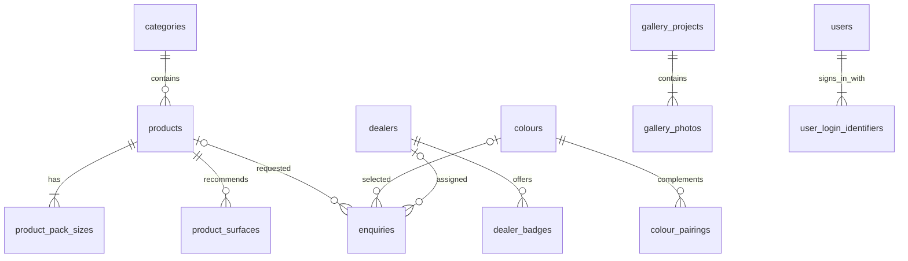

# Areva Paints SQL database layout

Reviewed **11 November 2026** against GitHub `main` commit **7d0656e**. The proposal now has **19 tables**, including the Gallery reviews addition (13 November 2026). This review adds created user accounts, their shared login-identifier namespace, private activity events and the history start date. Existing product, gallery, colour and dealer tables remain compatible.

Proposed database: **PostgreSQL 16 or newer**, available as Render Postgres. This is a design and schema, ready for review. It does not connect the website to SQL or move existing data. Admin content currently lives in `.local/content/content.json` (or `CONTENT_DATA_DIR`); enquiries now persist privately in `CONTENT_DATA_DIR/enquiries.json`.

**Using Supabase instead:** follow [supabase-setup.md](supabase-setup.md) and its single [supabase-setup.sql](../database/supabase-setup.sql) file. That alternative creates the same 19 tables and category seed in a private `areva` schema with restricted API-role access and RLS, without modifying Supabase Auth. Do not combine that setup with the ordinary public-schema scripts below. The project URL alone does not provide SQL access.

Use [schema.sql](../database/schema.sql) to create the tables in a **new, empty** database, followed by [seed-categories.sql](../database/seed-categories.sql) for the existing eight product categories. SQL identifiers use snake_case; the current API keeps its camelCase names.

If you already ran the earlier **15-table** proposal, run [001-users-and-activity.sql](../database/migrations/001-users-and-activity.sql) **once** instead of rerunning `schema.sql`. The upgrade adds three private/account tables and one column without dropping existing content. It does not import live JSON records. Do not run the upgrade on a fresh database created with the revised schema; those additions are already included. For the old-schema route, follow migration 001 with migrations 002, 003, 004 and 005 in order. Back up and rehearse either route on staging first.

## Database access guardrails (14 November 2026)

Fresh `schema.sql` now enables row-level security on all 19 application tables and revokes access from `PUBLIC` and existing Supabase browser/API roles (`anon`, `authenticated`, `service_role`). No browser access policies are created. The login identifier trigger qualifies its writes using the triggering table’s schema and pins its search path. A dedicated backend SQL role and its least-privilege/RLS strategy must be designed with the future adapter; do not use a browser key or grant visitors access to users, enquiries or activity.

For an existing installation that already has migrations 001–004, review and apply [005-private-access-guardrails.sql](../database/migrations/005-private-access-guardrails.sql) once. It revokes prior direct application-table access and preserves unrelated tables. If both `areva.users` and `public.users` exist, it stops for inspection. The migration changes permissions; rehearse it against a backup and assess any existing integrations. No SQL has been applied to the live project during this review.

Tests execute fresh public/private schemas, permission denials, hostile-search-path trigger calls, preserved unrelated tables and repeat-install rollback in isolated PGlite instances. Run `npm test` for these checks alongside the application regressions. This verifies the scripts, not the live Supabase configuration.

## Relationships

**PK** = primary key, the unique identifier. **FK** = foreign key, a link to a parent table. A parent can have many child rows.

Landing images, PDF shade cards, ads and reviews are independent entries. `site_state` holds one revision number for the whole website and the private history start date. Activity events keep actor/entity snapshots without foreign keys so deleted entries and the environment admin remain readable in history. The schema permits creating parents before their children; the service must require at least one pack size per product and one photo per project before committing.

## Main tables and their columns

### 1. categories — parent for products

| Column | SQL type | Purpose |
| --- | --- | --- |
| id | varchar(100), PK | Existing slug, for example `interior`, `exterior` or `waterproofing` |
| name | varchar(100) | Display name |
| icon | text | Category emoji |
| description | text | Card/category description |
| accent_color | varchar(7) | Six-digit HEX colour |
| position | integer | Preserve category order, starting at 0 |

The illustrated home cards use `src/data/categoryArt.ts`, `CategorySceneCard.tsx` and `public/assets/category-scenes.css`. After selecting a category, a separate full-width landing banner uses `src/data/categoryLandings.ts`, `CategoryLandingHero.tsx`, `public/assets/category-landings.css` and its own local `landing-*.webp` scene. These decorative images, palette values, live headings and range-feature labels remain code configuration. No extra image table, duplicated product image or change to these category columns is needed. Category `accent_color` still maps to `CATEGORIES[].accentColor`; it is not the new card's entire visual palette. The brand hero is also a static asset/component; uploaded landing campaigns remain in `landing_images`.

### 2. products — one row per product

| Column | SQL type | Purpose |
| --- | --- | --- |
| id | varchar(100), PK | Keep the current product ID, including legacy IDs |
| category_id | varchar(100), FK → categories.id | Product category |
| name | varchar(150) | Product name |
| tagline | varchar(500) | Optional short description |
| description | text | Full product description |
| image_url | text | Uploaded image path or existing image endpoint |
| coverage_sq_ft_per_unit | numeric | Square feet covered per coat; 0 means not configured |
| coverage_unit | varchar(2) | `L` or `kg` |
| calculation_basis | varchar(5) | `wall` or `floor` |
| recommended_coats | smallint | 1–10 coats |
| sheen | varchar(100) | Free-text finish, such as High Sheen or Soft Sheen |
| voc_level | varchar(30) | Current VOC choices |
| washability | varchar(30) | Current washability choices |
| tintable | boolean | Supports tinting |
| featured | boolean | Featured in catalogue |
| drying_time | text | Technical drying information |
| recoat_time | text | Time between coats |
| thinned_with | text | Thinning instructions |
| warranty_years | numeric | 0–100; preserve current data |
| surface_preparation | text | Preparation instructions |
| application_method | text | Brush/roller/application information |
| position | integer | Preserve catalogue order |
| created_at, updated_at | timestamptz | Server-controlled timestamps |

Coverage belongs **only here**. The product list and calculator must read these same columns. A separate paint-coverage table would duplicate the data.

Example: a product with coverage **120 sq ft/L**, 2 coats, a 1,000 sq ft area and a 10% allowance needs `1000 × 2 ÷ 120 × 1.10 = 18.33 L`. Coverage 0 excludes a product from estimates. The user's calculator allowance remains a request value, not a product column.

`categoryName` is derived by joining categories; do not store a second copy. The API's existing `coverageSqFtPerLiter` maps to `coverage_sq_ft_per_unit`, including products measured in kg. The technical columns are assembled back into the API's `specs` object.

### 3–4. Product child tables

| Table | Columns | Parent relationship |
| --- | --- | --- |
| product_pack_sizes | **product_id** varchar(100), **position** smallint, size numeric | FK → products.id; PK = (product_id, position). Example sizes: 1, 4, 10, 20 |
| product_surfaces | **product_id** varchar(100), **position** smallint, surface_name varchar(200) | FK → products.id; PK = (product_id, position). Example: plaster, concrete |

Pack sizes use their parent's `coverage_unit`. These rows replace `availableSizes[]` and `specs.recommendedSurfaces[]`, preserving array order.

### 5–6. Authorised dealers

| Table | Columns |
| --- | --- |
| dealers | **id** varchar(100) PK; name varchar(500); phone varchar(25); address, city, state varchar(500); pin_code varchar(6); position integer; created_at, updated_at timestamptz |
| dealer_badges | **dealer_id** varchar(100) FK → dealers.id; **position** smallint; badge varchar(100). PK = (dealer_id, position) |

Phone and PIN are text, so formatting and leading zeros survive. Badges replace the existing `badges[]` array.

### 7. landing_images

| Column | SQL type | Purpose |
| --- | --- | --- |
| id | varchar(100), PK | Existing slide ID |
| image_url | text | Required image path |
| label | varchar(150) | Optional caption/alt text |
| subtitle | varchar(150) | Existing `roomType` field |
| recommended_product_text | varchar(200) | Existing optional `recommendedProduct` text |
| position | integer | Carousel order |

The current recommended-product field accepts free text, so it is deliberately not a product FK. This preserves existing captions and recommendations during migration.

### 8–10. Colours and PDF shade cards

| Table | Columns |
| --- | --- |
| colours | **code** varchar(40) PK; name varchar(150); hex varchar(7); family varchar(30); tones text[]; position integer |
| colour_pairings | **colour_code** varchar(40) FK → colours.code; **position** smallint; matching_hex varchar(7). PK = (colour_code, position) |
| shade_cards | **id** varchar(100) PK; title varchar(150); pdf_url text; family varchar(30), default All Shades; tones text[]; position integer |

The palette uses ten families (Oranges, Yellows, Greens, Blues, Violets, Earth Tones, Classic Neutrals, Dark Accents, Whispering Whites, Reds & Pinks). `tones` stores zero or more of Cool, Dark, Light, Pastel, Vibrant, Warm; filter counts overlap. PDFs can use All Shades for a general document. Both arrays default to empty. Old family values remain accepted for migration; the application normalizes them from their saved HEX, preserving names/codes/HEX and allowing admin corrections. Existing installations need `database/migrations/002-shade-families-and-tones.sql` once (private `areva` or ordinary `public`; fresh setup already includes it). Map JSON `colours[].tones`, `shadeCards[].family` and `shadeCards[].tones` in a future SQL adapter.

Colour codes are unique ignoring case. Keep existing code strings during migration; subsequent lookups should use the same case-insensitive normalization as the API. `goesWellWith[]` contains HEX values, so pairing rows do not require another colour to exist in the library.

### 11–13. Gallery and ads

| Table | Columns |
| --- | --- |
| gallery_projects | **id** varchar(100) PK; title varchar(150); location varchar(200); description text; position integer; created_at, updated_at timestamptz |
| gallery_photos | **project_id** varchar(100) FK → gallery_projects.id; **id** varchar(100); image_url text; caption varchar(300); position smallint. PK = (project_id, id); unique (project_id, position) |
| gallery_ads | **id** varchar(100) PK; title varchar(150); channel varchar(7); image_url text; description varchar(2000); link_url text; position integer; created_at, updated_at timestamptz |

Ads use `digital` or `social`. At least an image or a link is required. The SQL includes a basic HTTPS check; the server must retain full URL validation. First project photo is the cover. Photo IDs are unique within their project, matching the current API. Sort projects and ads by `updated_at DESC, position DESC` to retain current ordering and tie-breaking.

### 14. site_state — save/revision control

| Column | SQL type | Purpose |
| --- | --- | --- |
| id | smallint, PK | Always 1; only one row |
| revision | bigint | Current content revision |
| updated_at | timestamptz | Last successful website save |
| history_started_at | timestamptz, nullable | Exact `adminHistory.startedAt`; NULL means history has not started |

The existing admin saves a whole content workspace. A SQL implementation must lock this row with `SELECT ... FOR UPDATE`, compare the submitted revision, save all changed parent/child rows and their activity events in **one transaction**, increment revision once, then commit. Return HTTP 409 for stale revisions as today. Replacing whole tables must not delete unchanged gallery records and reset their dates. Successful saves record a `published` event even when no content fields changed; this action means **Save changes**, not a GitHub push or deployment.

Upload, admin sign-in/out and user-management events do **not** increment the content revision or change its last-save date. Set `history_started_at` to the first event's time only when previously NULL. Use the same row lock to serialize history append order and user changes across SQL-backed requests; user-cap/last-admin checks must happen inside that transaction. External credential hashing should finish before taking the lock, followed by rechecking the acting session and permissions. SQL integration must replace the synchronous JSON read/write flow with awaited database transactions rather than silently retaining stale in-memory snapshots.

### 15. enquiries — make enquiries persistent

| Column | SQL type | Purpose |
| --- | --- | --- |
| id | varchar(100), PK | Unique ticket ID, generated by the server |
| topic, full_name, phone, city | text | Customer/request details |
| product_id | varchar(100), nullable FK → products.id | Linked product when resolvable |
| product_name | text | Preserve submitted name |
| shade_code | varchar(40), nullable FK → colours.code | Linked colour when resolvable |
| shade_name, message | text | Preserve submitted shade/message |
| status | varchar(20) | `pending`, `in_review`, `assigned_to_dealer` |
| assigned_dealer_id | varchar(100), nullable FK → dealers.id | Dealer assignment |
| assigned_depot_text | text | Preserve existing assignment display text |
| created_at | timestamptz | Submission time |

Existing requests send product and shade names rather than IDs. Keep these text snapshots; resolve optional FKs only when there is a reliable match. Deleted products, shades or dealers set enquiry FKs to NULL and retain the request details. Generate collision-resistant IDs (for example UUID strings); the current five-digit random ticket approach should be replaced when SQL persistence is wired in.

### 16. users — private created accounts

| Column | SQL type | Current source / purpose |
| --- | --- | --- |
| id | varchar(100), PK | `users[].id`; preserve UUID strings; `environment-admin` is reserved |
| username | varchar(80) | `username`; trimmed lowercase, 3–80 allowed characters |
| email | varchar(160) | `email`; optional empty string, trimmed lowercase |
| name | varchar(100) | Display/full name |
| role | varchar(9) | `admin`, `customer`, `architect` or `builder` |
| active | boolean | Whether sign-in is enabled |
| password_hash | varchar(128) | `passwordHash`; 64-byte scrypt result encoded as 128 lowercase HEX characters |
| password_salt | varchar(32) | `passwordSalt`; random 16-byte salt encoded as 32 lowercase HEX characters |
| password_version | bigint | `passwordVersion`; starts at 1, increments on reset or active-status change |
| created_at, updated_at | timestamptz, nullable | Preserve existing `createdAt`/`updatedAt`; NULL for genuinely unknown dates |

Import existing hashes/salts/version **unchanged**; do not rehash a stored hash or require plaintext passwords. Current verification calls Node `scrypt(password, passwordSalt, 64)` using the stored HEX salt **as a string**, then compares the derived bytes to the HEX-decoded password hash. Preserve these exact semantics. New/reset passwords still use the current 12–128 character validation and fresh salt. Password hashes/salts and private account lists never belong in public `/api/content` or HTML; account/session responses return only safe fields.

Only authenticated admins can create/reset/disable users. Keep the maximum of 200 created accounts, fixed-at-creation roles, self-disable protection and last-active-admin protection. Resetting a password or changing active status increments `password_version`; protected requests must recheck it along with role/active status, including after re-enabling. A content save must never delete or replace user records supplied by a separate user-management operation.

The recovery admin (`environment-admin`) is synthesized from `ADMIN_USERNAME`/`ADMIN_PASSWORD`; do **not** insert it into `users`, seed a default password, or expose environment credentials. Its reserved normalized username must also be checked by the account service when creating accounts. Changing that environment setting needs a collision check against existing login identifiers.

### 17. user_login_identifiers — one login namespace per account

| Column | SQL type | Purpose |
| --- | --- | --- |
| identifier | varchar(160), PK | Normalized username or nonempty email; globally unique across both kinds |
| user_id | varchar(100), FK → users.id | Owning account; cascades only if that user is removed |

A trigger derives these rows from each inserted/updated `users` row. One account with identical username and email gets one identifier; omitted email produces no empty identifier. This prevents user A's username matching user B's email, which two separate unique indexes would not prevent. Concurrent conflicts roll back the entire statement. Import **users first** and let the trigger populate this child table; do not disable the trigger or write the child independently. For SQL-backed login, normalize the input using the same trim/lowercase rules, look up the identifier, join its user and retain all role/password/session checks. The environment username reservation remains an application rule because its value lives outside PostgreSQL.

### 18. activity_events — admin-only saved history

| Column | SQL type | Current source / purpose |
| --- | --- | --- |
| id | varchar(100), PK | `adminHistory.events[].id`; preserve existing event IDs |
| event_sequence | bigint, unique identity | Database append order; import in the original event-array order |
| occurred_at | timestamptz | `at`; preserve exact recorded time |
| actor | text | `actor`; username snapshot, including environment/shared accounts |
| action | varchar(20) | `created`, `updated`, `deleted`, `reordered`, `uploaded`, `published`, `signed_in`, `signed_out` |
| section | varchar(30) | Current API section key, listed below |
| entity_id | text | `entityId`; may be empty; project photo IDs use `projectId/photoId` |
| label | text | Entry label or upload display filename |
| changed_fields | text[] | `fields[]`; field paths only, such as `specs.dryingTime`, `password` or `order`; never secret values |
| revision | bigint, nullable | `revision`; optional for uploads/login/user events; do not fill missing values with 0 |
| file_url | text, nullable | Optional `fileUrl`; preserve `/uploads/...` |
| bytes | bigint, nullable | Optional `bytes`; uploaded file size, not file data |

Section keys are `landingImages`, `products`, `dealers`, `colours`, `shadeCards`, `galleryProjects`, `galleryPhotos`, `galleryAds`, `galleryReviews`, `uploads`, `website`, `account`, `users`. Keep this camelCase vocabulary in values even though SQL column names use snake_case.

History tabs are filters, **not** separate tables: Gallery combines `galleryProjects`, `galleryPhotos`, `galleryAds`, `galleryReviews`; Colours & shade cards combines `colours`, `shadeCards`; Landing images, Products and Authorised dealers select their matching section. All activity includes Users, account events and generic uploads. Preserve `tab`, `section`, `action`, search and pagination behaviour from `GET /api/admin/history`; page size stays capped at 50. Only admin authentication events are currently recorded, not Customer/Architect/Builder logins.

Read pages by `event_sequence DESC`, matching the current reversed append-only array even when timestamps tie or the clock changes. Insert imported events one at a time in their original array order while letting the identity generate sequences. If an importer sets explicit sequences, advance the identity after import. Do not sort the original array by timestamp. Derive latest-entry ages from the last `created`/`updated` event for `(section, entity_id)`, latest-section times from `created`/`updated`/`deleted`/`reordered`, and last website-save time from `published`, all using append order. Store timestamps, not a changing “days ago” number; calculate relative ages in the UI. Older entries without tracked dates remain untracked.

There is deliberately no entity/user FK on the event snapshots: deleted products/photos and the environment admin must remain visible, and old shared usernames cannot be assigned retrospectively to individual staff. Preserve events when deleting content. Content edits, user mutations and their events each commit atomically; failed validations/conflicts create no corresponding saved-change events. An uploaded file may remain after a failed DB write because file storage and SQL do not share a transaction; return an error and reconcile orphan files rather than reporting a successful logged upload. There is no retention trimming, history-edit/delete API or tamper-proof audit guarantee in the current app. Keep history tables and queries outside public serialization.

### Product display details and warranty — 14 November 2026

The product editor exposes all public technical fields. `sheen` is now free text (`varchar(100)`, nonblank). Additional `products` columns map to optional `specs` properties: `coverage_text varchar(300)` → `specs.coverageText`; `dilution varchar(300)` → `specs.dilution`; `bases varchar(100)[]` → `specs.bases` (up to 30 entries); `packing varchar(100)[]` → `specs.packing` (up to 20 entries); `warranty_label varchar(100)` → `specs.warrantyLabel`. Strings default to empty and arrays to empty arrays. The API rejects blank list items, excessive lengths and invalid numeric pack sizes. Comma-separated input is an editor convenience; arrays are stored without losing base codes such as `017`.

`specs.warrantyYears` continues to map to `warranty_years` (0–100). Positive values show the gold duration/label badge at the top-right of the dark product summary; zero hides it. An empty label uses Performance warranty*. Free display coverage and packing labels do not replace numeric calculator coverage or `product_pack_sizes`. Existing numeric values supply display fallbacks when overrides are blank. Preserve the new optional properties if older clients omit them; empty strings/arrays clear overrides. Existing installations apply `database/migrations/004-product-display-details.sql` once, in either `public` or private `areva`; fresh setup includes it. No live database connection/import is implemented by this change.

### 19. gallery_reviews — Gallery customer reviews

| SQL column | API field / meaning |
| --- | --- |
| id varchar(100) PK | `id` |
| name varchar(150), nonblank | `name`, reviewer name |
| detail varchar(200), default empty | `detail`, optional location/description |
| review_text varchar(2000), nonblank | `text`, full review with line breaks |
| image_url text, default empty | `image`, optional uploaded or validated image URL |
| position integer >= 0 | Saved array order; breaks equal-date ties |
| created_at, updated_at timestamptz | `createdAt`, `updatedAt`; assigned/preserved by the server |

Existing databases use `database/migrations/003-gallery-reviews.sql` once. It detects a `public` or private `areva` install, stops if both exist, creates this table and permits `galleryReviews` activity events. The private-schema path enables RLS and revokes browser-role access to the new table. Fresh schema/setup already includes it. Import `galleryReviews[]` in the same content/history transaction; up to 100 reviews, optional images use the existing 25 MiB upload path. Preserve rows when older clients omit the section. This is an SQL design update, not a live migration or backend connection.

## Defaults, ordering and limits

Optional text uses an empty string for compatibility; nullable enquiry FKs mean “no linked record.” Use text IDs to preserve existing IDs instead of converting everything to integers/UUID columns. `position` preserves the order of arrays from the JSON file; read by `position, id` (or colour code) unless newest-first gallery sorting applies.

The API must still enforce overall limits: 1–200 products, 500 dealers, 12 landing slides, 1–5,000 colours, 50 shade cards, 100 projects, 100 ads, 100 reviews, 1–20 pack sizes, up to 30 recommended surfaces, 1–20 photos per project, 10 dealer badges, 20 matching HEX colours and 200 created users. At least one product must retain positive coverage. Cross-row minimums, the user cap, reserved environment username and last-admin rule are service rules, not fully enforced by these table definitions.

The SQL sets initial timestamps using `now()`; the future server integration must update `updated_at` on meaningful changes. Preserve existing gallery `createdAt` and `updatedAt` on import and unrelated saves. There are no automatic timestamp triggers in this proposal.

Current product/dealer JSON records do not carry their own `createdAt`/`updatedAt` fields. Their SQL timestamps initially describe import/database writes, not proven historical creation dates. Continue deriving the admin's “updated … ago” display from preserved activity events; do not display a migration-time default as an original upload/update date. Likewise, `site_state.updated_at` starts at schema creation and is not evidence of a pre-tracking website save.

The only trigger added here synchronizes login identifiers. PostgreSQL drivers commonly return `bigint` values as strings: convert API revision/password-version/byte values only after checking JavaScript safe-integer bounds, and keep internal event ordering accurate. Optional event fields omitted in JSON map to SQL NULL and should be omitted again in the reconstructed API event. Unknown history start/user dates map to NULL. Do not let default `now()` fabricate imported dates.

## Images, PDFs and administration

Store image/PDF **paths or URLs**, not file bytes or base64, in these tables. Existing `/uploads/...` and `/api/content/legacy-image/...` URLs must continue to resolve. PostgreSQL does not back up uploaded files: retain the Render persistent disk or move files to object storage, and back up both content and assets. Image uploads remain 25 MB; shade-card PDFs remain 5 MB.

Admin login now supports both the server-configured recovery admin and individually created admins; other accounts use the separate public login. These SQL files preserve the created accounts in `users` and history in `activity_events` **when an adapter/import is implemented**. Current sessions and login-attempt limits remain memory maps in `accounts.ts`, with separate `areva_admin`/`areva_user` cookies, eight-hour expiry and logout revocation. No sessions table is required to keep current restart-expiry behaviour. SQL account storage alone does not enable multiple replicas: shared sessions/rate limits and transactional writes must be designed before horizontal scaling. Database credentials belong in a server-side `DATABASE_URL`, never frontend configuration. `GET /api/enquiries` is admin-protected in the latest code.

Upload metadata already fits existing content URL columns plus private `uploaded` events (`label`, `file_url`, `bytes`, `occurred_at`, `actor`, `section`). A separate upload registry is optional future asset-management work, not required by the current feature set. No image/PDF bytes, preview base64, session tokens or passwords should be imported into public content columns.

## Render setup and migration sequence

1. Create a **Render Postgres** database in the same region as the Node Web Service. Copy its Internal Database URL into the Web Service's `DATABASE_URL` environment secret. The static frontend does not connect directly to SQL.
2. Using a SQL client connected to a new database, run `database/schema.sql`, then `database/seed-categories.sql`. For `psql`, use `psql "$DATABASE_URL" -v ON_ERROR_STOP=1 -f database/schema.sql` and then the same command with `database/seed-categories.sql`. If the earlier 15-table proposal already exists, use `psql "$DATABASE_URL" -v ON_ERROR_STOP=1 -f database/migrations/001-users-and-activity.sql` once instead; do not reseed or rerun the new full schema. Run from a trusted terminal with access to the database; the internal URL is reachable only from the appropriate Render network.
3. Implement and test an asynchronous PostgreSQL repository/adapter for content, `readUsers`/`saveUsers`, `readActivity`/`recordActivity` and the private enquiry file. Authentication in `accounts.ts`, validation/saves in `routes.ts` and the public HTML renderer must use the same persisted state. Setting `DATABASE_URL` alone currently does nothing. Keep public API response shapes, private-data exclusions and admin validation unchanged.
4. Back up the latest live `content.json`, `enquiries.json` and uploads. Read the complete private file through a trusted server-side importer: `/api/content` **and** `/api/admin/content` omit users/history and cannot supply a full migration. Import actual live content once in a transaction, preserving IDs, array positions, product specs and gallery timestamps. Insert created users with unchanged hashes/salts/version/dates (the identifier trigger runs automatically), append history events in stored array order, and import `revision` plus `adminHistory.startedAt` into `site_state`. Preflight counts, normalized identifier conflicts/reserved username and missing assets; abort/roll back on mismatches. Do not replace live content with development defaults or create fictional historical events. Missing `users`/`adminHistory` in older files means empty private tables and NULL history start. Import current `enquiries.json` separately; enquiries lost before private persistence was added cannot be recovered retrospectively.
5. Verify admin save/reload, revision conflicts, the calculator, every product category, dealer/colour search, uploads, albums, ads and enquiry persistence on staging. Also verify existing passwords still sign in, all four roles remain separated, users/history remain private, duplicate username/email races fail, resets/disable/logout revoke sessions, self/last-admin protections work, history tabs/order/relative ages survive restart, no-op saves retain their events and user/upload events retain the content revision. Back up and test restoration of database plus uploaded assets.
6. Schedule the final switch, briefly pause admin writes/submissions, import the final snapshot and resume with the SQL-backed server. Keep the old files as a rollback backup. No production database is changed by this proposal.

## Validation performed

The original schema/category seed passed isolated PostgreSQL-engine (PGlite) execution and a trial mapping of all 18 default products, 13 dealers and 24 colours, including child arrays. Checks covered invalid coverage, case-insensitive colour-code uniqueness, category FKs, photo cascades and preservation of enquiry names after product deletion. The 11 November review additionally validates fresh creation and upgrading the old 15-table proposal, account/hash/identifier constraints, case-insensitive cross-identifier collision handling, password verification after import, history array order/optional fields and rollback of content/account/history transactions. These are isolated schema tests, not an executed migration of the live Render site. A staging adapter and migration of the latest live data remain necessary before production use.
