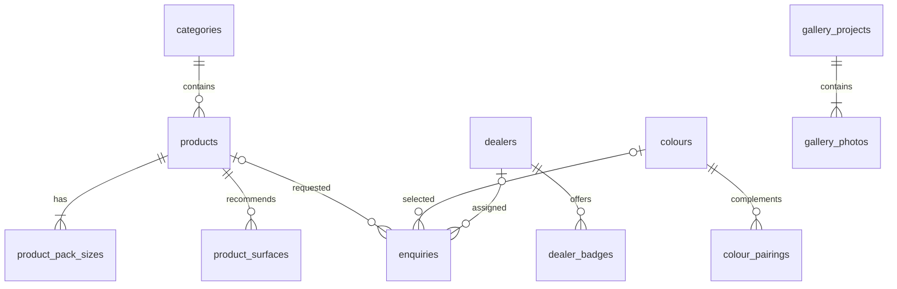

# Areva Paints SQL database layout

Proposed database: **PostgreSQL 16 or newer**, available as Render Postgres. This is a design and schema, ready for review. It does not connect the website to SQL or move existing data. Admin content currently lives in `.local/content/content.json` (or `CONTENT_DATA_DIR`); enquiries currently live in server memory and reset on restart.

Use [schema.sql](../database/schema.sql) to create the tables in a **new, empty** database, followed by [seed-categories.sql](../database/seed-categories.sql) for the existing eight product categories. SQL identifiers use snake_case; the current API keeps its camelCase names.

## Relationships

**PK** = primary key, the unique identifier. **FK** = foreign key, a link to a parent table. A parent can have many child rows.

Landing images, PDF shade cards and ads are independent entries. `site_state` holds one revision number for the whole website. The schema permits creating parents before their children; the service must require at least one pack size per product and one photo per project before committing.

## Main tables and their columns

### 1. categories — parent for products

| Column | SQL type | Purpose |
| --- | --- | --- |
| id | varchar(100), PK | Existing slug, for example `interior`, `exterior` or `waterproofing` |
| name | varchar(100) | Display name |
| icon | text | Category emoji |
| description | text | Card/category description |
| accent_color | varchar(7) | Six-digit HEX colour |
| position | integer | Preserve category order, starting at 0 |

### 2. products — one row per product

| Column | SQL type | Purpose |
| --- | --- | --- |
| id | varchar(100), PK | Keep the current product ID, including legacy IDs |
| category_id | varchar(100), FK → categories.id | Product category |
| name | varchar(150) | Product name |
| tagline | varchar(500) | Optional short description |
| description | text | Full product description |
| image_url | text | Uploaded image path or existing image endpoint |
| coverage_sq_ft_per_unit | numeric | Square feet covered per coat; 0 means not configured |
| coverage_unit | varchar(2) | `L` or `kg` |
| calculation_basis | varchar(5) | `wall` or `floor` |
| recommended_coats | smallint | 1–10 coats |
| sheen | varchar(30) | Current finish choices, such as Soft Sheen |
| voc_level | varchar(30) | Current VOC choices |
| washability | varchar(30) | Current washability choices |
| tintable | boolean | Supports tinting |
| featured | boolean | Featured in catalogue |
| drying_time | text | Technical drying information |
| recoat_time | text | Time between coats |
| thinned_with | text | Thinning instructions |
| warranty_years | numeric | 0–100; preserve current data |
| surface_preparation | text | Preparation instructions |
| application_method | text | Brush/roller/application information |
| position | integer | Preserve catalogue order |
| created_at, updated_at | timestamptz | Server-controlled timestamps |

Coverage belongs **only here**. The product list and calculator must read these same columns. A separate paint-coverage table would duplicate the data.

Example: a product with coverage **120 sq ft/L**, 2 coats, a 1,000 sq ft area and a 10% allowance needs `1000 × 2 ÷ 120 × 1.10 = 18.33 L`. Coverage 0 excludes a product from estimates. The user's calculator allowance remains a request value, not a product column.

`categoryName` is derived by joining categories; do not store a second copy. The API's existing `coverageSqFtPerLiter` maps to `coverage_sq_ft_per_unit`, including products measured in kg. The technical columns are assembled back into the API's `specs` object.

### 3–4. Product child tables

| Table | Columns | Parent relationship |
| --- | --- | --- |
| product_pack_sizes | **product_id** varchar(100), **position** smallint, size numeric | FK → products.id; PK = (product_id, position). Example sizes: 1, 4, 10, 20 |
| product_surfaces | **product_id** varchar(100), **position** smallint, surface_name varchar(200) | FK → products.id; PK = (product_id, position). Example: plaster, concrete |

Pack sizes use their parent's `coverage_unit`. These rows replace `availableSizes[]` and `specs.recommendedSurfaces[]`, preserving array order.

### 5–6. Authorised dealers

| Table | Columns |
| --- | --- |
| dealers | **id** varchar(100) PK; name varchar(500); phone varchar(25); address, city, state varchar(500); pin_code varchar(6); position integer; created_at, updated_at timestamptz |
| dealer_badges | **dealer_id** varchar(100) FK → dealers.id; **position** smallint; badge varchar(100). PK = (dealer_id, position) |

Phone and PIN are text, so formatting and leading zeros survive. Badges replace the existing `badges[]` array.

### 7. landing_images

| Column | SQL type | Purpose |
| --- | --- | --- |
| id | varchar(100), PK | Existing slide ID |
| image_url | text | Required image path |
| label | varchar(150) | Optional caption/alt text |
| subtitle | varchar(150) | Existing `roomType` field |
| recommended_product_text | varchar(200) | Existing optional `recommendedProduct` text |
| position | integer | Carousel order |

The current recommended-product field accepts free text, so it is deliberately not a product FK. This preserves existing captions and recommendations during migration.

### 8–10. Colours and PDF shade cards

| Table | Columns |
| --- | --- |
| colours | **code** varchar(40) PK; name varchar(150); hex varchar(7); family varchar(30); position integer |
| colour_pairings | **colour_code** varchar(40) FK → colours.code; **position** smallint; matching_hex varchar(7). PK = (colour_code, position) |
| shade_cards | **id** varchar(100) PK; title varchar(150); pdf_url text; position integer |

Colour codes are unique ignoring case. Keep existing code strings during migration; subsequent lookups should use the same case-insensitive normalization as the API. `goesWellWith[]` contains HEX values, so pairing rows do not require another colour to exist in the library.

### 11–13. Gallery and ads

| Table | Columns |
| --- | --- |
| gallery_projects | **id** varchar(100) PK; title varchar(150); location varchar(200); description text; position integer; created_at, updated_at timestamptz |
| gallery_photos | **project_id** varchar(100) FK → gallery_projects.id; **id** varchar(100); image_url text; caption varchar(300); position smallint. PK = (project_id, id); unique (project_id, position) |
| gallery_ads | **id** varchar(100) PK; title varchar(150); channel varchar(7); image_url text; description varchar(2000); link_url text; position integer; created_at, updated_at timestamptz |

Ads use `digital` or `social`. At least an image or a link is required. The SQL includes a basic HTTPS check; the server must retain full URL validation. First project photo is the cover. Photo IDs are unique within their project, matching the current API. Sort projects and ads by `updated_at DESC, position DESC` to retain current ordering and tie-breaking.

### 14. site_state — save/revision control

| Column | SQL type | Purpose |
| --- | --- | --- |
| id | smallint, PK | Always 1; only one row |
| revision | bigint | Current content revision |
| updated_at | timestamptz | Last successful website save |

The existing admin saves a whole content workspace. A SQL implementation must lock this row with `SELECT ... FOR UPDATE`, compare the submitted revision, save all changed parent/child rows in **one transaction**, increment revision once, then commit. Return HTTP 409 for stale revisions as today. Replacing whole tables must not delete unchanged gallery records and reset their dates.

### 15. enquiries — make enquiries persistent

| Column | SQL type | Purpose |
| --- | --- | --- |
| id | varchar(100), PK | Unique ticket ID, generated by the server |
| topic, full_name, phone, city | text | Customer/request details |
| product_id | varchar(100), nullable FK → products.id | Linked product when resolvable |
| product_name | text | Preserve submitted name |
| shade_code | varchar(40), nullable FK → colours.code | Linked colour when resolvable |
| shade_name, message | text | Preserve submitted shade/message |
| status | varchar(20) | `pending`, `in_review`, `assigned_to_dealer` |
| assigned_dealer_id | varchar(100), nullable FK → dealers.id | Dealer assignment |
| assigned_depot_text | text | Preserve existing assignment display text |
| created_at | timestamptz | Submission time |

Existing requests send product and shade names rather than IDs. Keep these text snapshots; resolve optional FKs only when there is a reliable match. Deleted products, shades or dealers set enquiry FKs to NULL and retain the request details. Generate collision-resistant IDs (for example UUID strings); the current five-digit random ticket approach should be replaced when SQL persistence is wired in.

## Defaults, ordering and limits

Optional text uses an empty string for compatibility; nullable enquiry FKs mean “no linked record.” Use text IDs to preserve existing IDs instead of converting everything to integers/UUID columns. `position` preserves the order of arrays from the JSON file; read by `position, id` (or colour code) unless newest-first gallery sorting applies.

The API must still enforce overall limits: 1–200 products, 500 dealers, 12 landing slides, 1–5,000 colours, 50 shade cards, 100 projects, 100 ads, 1–20 pack sizes, up to 30 recommended surfaces, 1–20 photos per project, 10 dealer badges and 20 matching HEX colours. At least one product must retain positive coverage. Cross-row minimums and total row counts are service rules, not fully enforced by these table definitions.

The SQL sets initial timestamps using `now()`; the future server integration must update `updated_at` on meaningful changes. Preserve existing gallery `createdAt` and `updatedAt` on import and unrelated saves. There are no automatic timestamp triggers in this proposal.

## Images, PDFs and administration

Store image/PDF **paths or URLs**, not file bytes or base64, in these tables. Existing `/uploads/...` and `/api/content/legacy-image/...` URLs must continue to resolve. PostgreSQL does not back up uploaded files: retain the Render persistent disk or move files to object storage, and back up both content and assets. Image uploads remain 25 MB; shade-card PDFs remain 5 MB.

Admin login currently uses environment credentials and in-memory sessions. These SQL files do not change authentication or add a default password. An `admin_users` table is only needed if individual staff accounts are implemented later; store password hashes, never plain passwords. Database credentials belong in a server-side `DATABASE_URL`, never frontend configuration.

## Render setup and migration sequence

1. Create a **Render Postgres** database in the same region as the Node Web Service. Copy its Internal Database URL into the Web Service's `DATABASE_URL` environment secret. The static frontend does not connect directly to SQL.
2. Using a SQL client connected to a new database, run `database/schema.sql`, then `database/seed-categories.sql`. For `psql`, use `psql "$DATABASE_URL" -v ON_ERROR_STOP=1 -f database/schema.sql` and then the same command with `database/seed-categories.sql`. Run from a trusted terminal with access to the database; the internal URL is reachable only from the appropriate Render network.
3. Implement and test a PostgreSQL repository/adapter in place of `content-store.ts` and the enquiry memory array. Setting `DATABASE_URL` alone currently does nothing. Keep the public API response shape and admin validation unchanged.
4. Back up the latest live `content.json` and uploads. Import actual live content once in a transaction, preserving IDs, array positions, product specs and gallery timestamps. Do not replace live content with the development seed. Import the current revision into site_state. Enquiries already lost during server restarts cannot be recovered from the current memory-only store.
5. Verify admin save/reload, revision conflicts, the calculator, every product category, dealer search, colour search, uploads, project albums, ads and enquiry persistence on a staging service. Back up and test restoration of database plus uploaded assets.
6. Schedule the final switch, briefly pause admin writes/submissions, import the final snapshot and resume with the SQL-backed server. Keep the old files as a rollback backup. No production database is changed by this proposal.

## Validation performed

The schema and category seed executed successfully in an isolated PostgreSQL engine (PGlite). A trial import accepted all 18 default products, 13 dealers and 24 colours, including their child arrays. Checks also confirmed invalid coverage rejection, case-insensitive colour-code uniqueness, category foreign keys, photo cascades and enquiry-name preservation after a product is deleted. This validates the proposed SQL and default-data mapping; a staging migration of the latest live data remains necessary before production use.
